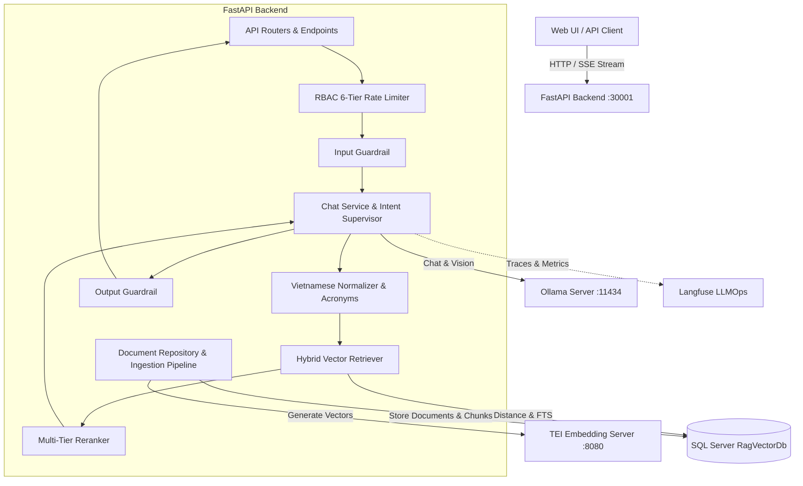

# Rag Assistant

[](https://fastapi.tiangolo.com)
[](https://www.python.org/)
[](https://ollama.com/)
[](https://github.com/huggingface/text-embeddings-inference)
[](https://www.microsoft.com/sql-server)

> **Rag Assistant** is a standalone, multimodal AI-powered knowledge assistant featuring Multimodal Vision & Text support, True Hybrid Search (Vector Cosine + Full-Text Search + Reciprocal Rank Fusion) combined with Dynamic Top-K and Adjacent Chunk Expansion, Multi-Tier Reranking, Vietnamese text normalization and acronym expansion, Role-Based Access Control (RBAC), a 6-tier Rate Limiter, and a modern Gemini-style Web UI with real-time streaming via Server-Sent Events (SSE).

---

## Table of Contents

1. [Key Features](#key-features)
2. [System Architecture](#system-architecture)
3. [Project Directory Structure](#project-directory-structure)
4. [Quickstart & Installation Guide](#quickstart--installation-guide)
5. [Environment Variables Configuration](#environment-variables-configuration)
6. [API Endpoints Reference](#api-endpoints-reference)
7. [Testing & Quality Evaluation](#testing--quality-evaluation)
8. [Technical Documentation](#technical-documentation)

---

## Key Features

### 1. Dynamic AI Model Switcher

Switch seamlessly between local Large Language Models (LLMs) served via Ollama or vLLM:

- **Qwen 2.5 3B (`qwen2.5:3b`)**: Optimized for low latency and minimal resource consumption, perfect for fast Q&A and text-only queries.
- **Qwen 2.5-VL 7B (`qwen2.5vl:7b`)**: Multimodal vision-language model capable of deeply understanding text paired with screenshots, charts, tables, and software user interfaces.
- **DeepSeek-R1 7B (`deepseek-r1:7b`)**: Advanced reasoning with Chain-of-Thought (CoT), automatically parsed into an interactive `<think>` collapsible block on the UI.
- **Llama 3.2 3B (`llama3.2:3b`)**: General-purpose versatile assistant delivering concise and accurate responses.

### 2. Multimodal & Vision Mode

- **Toggleable Vision Mode**: Enable or disable image analysis per conversation turn.
- **Direct Clipboard Paste (`Ctrl + V`)**: Capture screenshots and paste them directly into the chat input for instant visual diagnostics.
- **OCR Tesseract & Qwen Vision Integration**: Extracts printed and handwritten text, button labels, input fields, and error dialogs to augment the conversation context.

### 3. True Hybrid Search & Reciprocal Rank Fusion (RRF)

- **1024-Dimensional Vector Search**: Powered by the multilingual `BAAI/bge-m3` embedding model via HuggingFace Text Embeddings Inference (TEI) with LRU caching.
- **Full-Text Search (FTS)**: Lexical queries executed through SQL Server `CONTAINSTABLE` with custom query parsing.
- **Reciprocal Rank Fusion (RRF)**: Merges dense vector and sparse keyword search rankings to deliver optimal retrieval precision.

### 4. Dynamic Top-K Retrieval

- **Query Complexity Analysis**: Dynamically computes optimal `k_vector` and `k_fts` values based on query length, keyword richness, and user intent confidence.
- **Context Compensation**: Automatically scales up chunk retrieval for exhaustive questions or when intent classification confidence falls below threshold.

### 5. Adjacent Chunk Expansion

- **Context Continuity**: Automatically fetches neighboring sibling chunks (`chunk_index ± window`) from the same source document when a relevant chunk is retrieved.
- **Prevents Fragmentation**: Ensures the LLM receives complete multi-step instructions, large tables, and continuous procedures split across chunk boundaries.

### 6. Vietnamese Text Processing & Normalization

- **`VietnameseNormalizer`**:
  - Standardizes Vietnamese diacritics to modern Unicode standard (NFC).
  - Removes text artifacts, trailing noise, and character elongation.
  - Automatically expands abbreviations and domain acronyms via customizable dictionary mapping (`bank_acronyms.json`).
  - Supports optional Vietnamese word segmentation via `underthesea`.
- **`normalize_for_match`**: Strips diacritics and cleans punctuation for precise fuzzy matching and keyword search queries.

### 7. Multi-Tier Reranking System

- **Flexible Factory Pattern**: Switch reranker backends via the `RERANKER_TYPE` environment variable:
  - `flashrank`: Ultra-fast, lightweight local ONNX-based reranker.
  - `cross_encoder`: Transformer-based cross-encoder (e.g., `BAAI/bge-reranker-base`) for highest relevance accuracy.
  - `disabled`: Bypasses the reranking step for minimum possible latency.
- **`rerank_with_scores`**: Returns ranked passages alongside confidence scores for threshold-based filtering.

### 8. Role-Based Access Control (RBAC) & 6-Tier Rate Limiting

- **SQL-Level Document Access Filtering**:
  - Filter by access scope: `accessScope` (`Public`, `Restricted`).
  - Filter by authorized roles: `allowedRoles`.
  - Filter by department ID: `departmentId`.
- **6-Tier Role-Based Rate Limiting**:
  - SuperAdmin: Unlimited
  - Admin: 120 requests/minute
  - Manager: 60 requests/minute
  - SeniorStaff: 40 requests/minute
  - Staff: 30 requests/minute
  - Guest: 10 requests/minute

### 9. Dual Guardrails

- **Input Guardrail**: Detects and intercepts prompt injection attempts, toxic inputs, and out-of-scope requests.
- **Output Guardrail**: Validates generated text, filters hallucinations, sanitizes sensitive information (PII/tokens), and ensures response safety.

### 10. Gemini-Inspired Standalone Web UI

- **Modern Dark Theme**: Standalone web client under `ui/` crafted with glassmorphic aesthetics and modern animations.
- **Real-Time Streaming via SSE**: Token-by-token response streaming with full Markdown, LaTeX math formulas, and syntax-highlighted code blocks.
- **Interactive Citations View**: Expandable source attribution displaying document filenames, page numbers, and exact text excerpts.
- **Knowledge Base Management Modal**: Drag-and-drop document upload (PDF, DOCX, XLSX, PPTX, TXT), real-time ingestion progress tracking, and document deletion.

### 11. LLMOps & Observability

- **Langfuse Integration**: Full end-to-end tracing across ingestion and chat pipelines, monitoring latency, token metrics, and output quality.
- **LangSmith Support**: Seamless export of evaluation traces and telemetries via standard environment variables.

---

## System Architecture

The project follows Clean Architecture and Domain-Driven Design principles:



---

## Project Directory Structure

```text
Rag/
├── app/                                 # FastAPI application source code (Clean Architecture)
│   ├── ai/                              # AI subsystem
│   │   ├── agent/                       # LangGraph Orchestration & Intent Supervisor
│   │   │   ├── agentic_rag/             # Fast Pipeline RAG nodes & state management
│   │   │   ├── faq/                     # FAQ fast-retrieval agent
│   │   │   └── supervisor/              # Supervisor Intent Router
│   │   ├── eval/                        # Evaluation metrics (HitRateAtK, MRRAtK, CitationPrecision)
│   │   ├── guardrails/                  # Input & Output Guardrails
│   │   ├── rag/                         # Core RAG subsystem
│   │   │   ├── chunking/                # Hierarchical & semantic text chunkers
│   │   │   ├── citation/                # Citation formatting & deduplication
│   │   │   ├── embedding/               # TeiEmbeddingService (BAAI/bge-m3 with LRU cache)
│   │   │   ├── ingestion/               # Ingestion pipeline, OCR & Langfuse tracing
│   │   │   ├── query/                   # Query contextualizer & rewriter
│   │   │   ├── reranker/                # FlashRank, CrossEncoder, Disabled, Factory
│   │   │   ├── retrieval/               # Hybrid Retriever, Dynamic Top-K, Adjacent Expansion
│   │   │   └── text/                    # VietnameseNormalizer, acronym dictionary, match normalizer
│   │   └── vision/                      # Tesseract OCR & Vision captioner
│   ├── core/                            # Configuration, Database ORM, Security, Middleware
│   ├── llmops/                          # Langfuse & LangSmith telemetry handlers
│   ├── modules/                         # Business feature modules
│   │   ├── chat/                        # Chat service, SSE streaming, message repository
│   │   ├── document/                    # Document repository (SQL Server Vector, FTS, RBAC)
│   │   └── health/                      # Health check endpoints
│   ├── routers/                         # FastAPI routing & dependency injection
│   ├── security/                        # RBAC Rate Limiter & security policies
│   ├── shared/                          # Utility classes & enums
│   ├── lifespan.py                      # Application lifecycle manager
│   └── main.py                          # FastAPI entrypoint & static UI file server
│
├── configs/                             # Configuration files & dependency definitions
│   ├── pyproject.toml                   # Project metadata & tasks
│   ├── requirements.txt                 # Python dependencies
│   └── .env.example                     # Full environment variables template
│
├── database/                            # Database setup scripts
│   ├── setup.sql                        # SQL Server RagVectorDb schema & vector catalog setup
│   └── Db.bak                           # Database backup file
│
├── docs/                                # Technical documentation
│   ├── deployment_guide.md              # Deployment & operations guide
│   └── architecture/                    # Architectural specifications
│       ├── AI_AGENT_ARCHITECTURE.md     # Multi-agent & intent routing architecture
│       └── SYSTEM_ARCHITECTURE_GUIDE.md # System architecture guide
│
├── infra/                               # Container & orchestration configuration
│   ├── docker/
│   │   ├── docker-compose.yml           # Docker Compose running Ollama & TEI
│   │   └── Dockerfile                   # Dockerfile packaging the FastAPI backend
│   └── k8s/
│       └── rag-python.yaml              # Kubernetes Deployment & Service manifest
│
├── scripts/                             # Utility scripts
│   ├── deploy_python.ps1                # Automated deployment script
│   ├── run_eval.py                      # LLM evaluation script
│   └── test_advanced.py                 # Advanced feature test script
│
├── tests/                               # Automated test suite
│   ├── test_verify.py                   # Architectural verification tests
│   ├── test_advanced_features.py        # Guardrails, Eval metrics, and 6-Tier RBAC tests
│   └── test_rag_improvements.py         # Dynamic Top-K, Reranker, Normalizer, and Adjacent Chunk tests
│
├── ui/                                  # Standalone Web UI (Google Gemini style)
│   ├── index.html                       # HTML5 layout
│   ├── css/
│   │   └── style.css                    # Glassmorphism dark theme styling
│   └── js/
│       ├── app.js                       # SSE streaming, Model switcher, and Ingestion logic
│       └── markdown.js                  # Markdown parser & code syntax highlighting
│
└── .env                                 # Local environment variables configuration
```

---

## Quickstart & Installation Guide

### Step 1: Initialize SQL Server Database

Run the self-contained SQL script located in `database/`:

```bash
sqlcmd -S localhost -U sa -P YourPassword -i database/setup.sql
```

The script automatically sets up:

- The `RagVectorDb` database.
- The `RagDocuments` and `RagDocumentChunks` tables with `VECTOR(1024)` support.
- Full-Text Catalogs and Indexes on chunk text content.
- Metadata columns for RBAC access control (`accessScope`, `allowedRoles`, `departmentId`).

### Step 2: Launch Ollama & TEI via Docker Compose

```bash
cd infra/docker
docker compose up -d
```

Pull the required AI models into Ollama:

```bash
docker exec -it rag-ollama ollama pull qwen2.5:3b
docker exec -it rag-ollama ollama pull qwen2.5vl:7b
docker exec -it rag-ollama ollama pull deepseek-r1:7b
docker exec -it rag-ollama ollama pull llama3.2:3b
```

### Step 3: Setup Python Environment

Python 3.11 or higher is required. Using a virtual environment is strongly recommended:

```powershell
# Navigate to the project root directory
cd "f:\BKU\Nam 3\Intern\Intern\Rag"

# Create a virtual environment
python -m venv .venv
.\.venv\Scripts\activate   # On Windows

# Install required dependencies
pip install -r configs/requirements.txt
```

### Step 4: Configure Environment Variables

Copy the example configuration file and adjust parameters as needed:

```bash
cp configs/.env.example .env
```

### Step 5: Start FastAPI Backend Service

```bash
uvicorn app.main:app --host 0.0.0.0 --port 30001 --reload
```

### Step 6: Access the Web UI

Open your browser and navigate to:

- **Web UI Client**: `http://localhost:30001` (or `http://localhost:30001/ui`)
- **Interactive Swagger API Docs**: `http://localhost:30001/docs`

---

## Environment Variables Configuration

Key environment variables available in the `.env` file:

| Environment Variable                  | Default Value                | Description                                                |
| ------------------------------------- | ---------------------------- | ---------------------------------------------------------- |
| `SQLSERVER_CONNECTIONSTRING`          |                              | Connection string for SQL Server Vector database           |
| `TEI_URL`                             | `http://localhost:8080`      | URL of HuggingFace Text Embeddings Inference service       |
| `EMBEDDING_DIMS`                      | `1024`                       | Dimension size of vector embeddings (`BAAI/bge-m3`: 1024)  |
| `EMBEDDING_MODEL`                     | `BAAI/bge-m3`                | Embedding model identifier used on TEI                     |
| `UPRAG_LMSTUDIOENDPOINT`              | `http://localhost:11434/v1`  | OpenAI-compatible endpoint (Ollama or vLLM)                |
| `UPRAG_MODELID`                       | `qwen2.5:3b`                 | Default LLM model identifier for text responses            |
| `UPRAG_APIKEY`                        | `ollama`                     | API key for LLM service authentication                     |
| `RERANKER_TYPE`                       | `disabled`                   | Reranker type: `disabled`, `flashrank`, or `cross_encoder` |
| `RERANKER_MODEL`                      | `BAAI/bge-reranker-base`     | Model identifier when using `cross_encoder`                |
| `RAG_DYNAMIC_TOP_K_ENABLED`           | `true`                       | Toggle dynamic Top-K chunk calculation                     |
| `RAG_DYNAMIC_TOP_K_BASE`              | `5`                          | Baseline number of chunks to retrieve                      |
| `RAG_DYNAMIC_TOP_K_MIN`               | `3`                          | Minimum number of retrieved chunks                         |
| `RAG_DYNAMIC_TOP_K_MAX`               | `10`                         | Maximum number of retrieved chunks                         |
| `RAG_DYNAMIC_TOP_K_COMPLEX_BONUS`     | `2`                          | Additional chunks for complex queries                      |
| `RAG_DYNAMIC_TOP_K_SIMPLE_DISCOUNT`   | `1`                          | Chunk reduction for simple queries                         |
| `RAG_DYNAMIC_TOP_K_LOW_CONF_BOOST`    | `2`                          | Additional chunks when intent confidence is low            |
| `RAG_DYNAMIC_TOP_K_CONF_THRESHOLD`    | `0.6`                        | Confidence threshold to trigger low-confidence boost       |
| `RAG_ADJACENT_EXPANSION_ENABLED`      | `true`                       | Toggle adjacent sibling chunk expansion                    |
| `RAG_ADJACENT_EXPANSION_WINDOW`       | `1`                          | Window size for adjacent preceding/succeeding chunks       |
| `RAG_ENABLE_VIETNAMESE_NORMALIZATION` | `true`                       | Toggle Vietnamese text normalization and acronym expansion |
| `RAG_NORMALIZATION_USE_SEGMENTATION`  | `false`                      | Toggle Vietnamese word segmentation using `underthesea`    |
| `LANGFUSE_PUBLIC_KEY`                 |                              | Public Key for Langfuse tracing                            |
| `LANGFUSE_SECRET_KEY`                 |                              | Secret Key for Langfuse tracing                            |
| `LANGFUSE_HOST`                       | `https://cloud.langfuse.com` | Host endpoint of Langfuse instance                         |

---

## API Endpoints Reference

| Method   | Endpoint                              | Description                                                      |
| -------- | ------------------------------------- | ---------------------------------------------------------------- |
| `GET`    | `/`                                   | Standalone Google Gemini-style Web UI                            |
| `GET`    | `/health`                             | Basic liveness probe endpoint                                    |
| `GET`    | `/api/v1/health`                      | Comprehensive health check (Database, TEI, and LLM connectivity) |
| `GET`    | `/api/v1/models`                      | List available AI models and their operational status            |
| `POST`   | `/api/v1/chat/stream`                 | Send user message and receive real-time SSE streaming response   |
| `POST`   | `/api/v1/conversations`               | Create a new chat session                                        |
| `GET`    | `/api/v1/conversations`               | Retrieve user conversation history list                          |
| `GET`    | `/api/v1/conversations/{id}/messages` | Retrieve detailed messages within a conversation session         |
| `POST`   | `/api/v1/document/upload`             | Upload documents to knowledge base (Background task ingestion)   |
| `GET`    | `/api/v1/document/tasks/{taskId}`     | Track real-time ingestion processing progress                    |
| `GET`    | `/api/v1/document/documents`          | List all indexed documents in the vector database                |
| `DELETE` | `/api/v1/document/documents/{id}`     | Delete a document and all its corresponding vector chunks        |

---

## Testing & Quality Evaluation

The repository includes comprehensive automated tests covering all critical components:

```bash
# 1. Architectural verification & route inspection
pytest tests/test_verify.py -v

# 2. Advanced features (Guardrails, Evaluation metrics, 6-Tier Rate Limiter)
pytest tests/test_advanced_features.py -v

# 3. RAG improvements (Dynamic Top-K, Reranker, Normalizer, Adjacent Chunk Expansion)
pytest tests/test_rag_improvements.py -v

# 4. Run full test suite
pytest tests/ -v
```

---

## Technical Documentation

For deeper insights into the architecture and operational details, refer to the guides in `docs/`:

- **Installation & Deployment Guide**:
  - [English Version](docs/deployment_guide.md)
  - [Bản Tiếng Việt](docs/deployment_guide_vi.md)
- **AI Agent & Intent Routing Architecture**:
  - [English Version](docs/architecture/AI_AGENT_ARCHITECTURE.md)
  - [Bản Tiếng Việt](docs/architecture/AI_AGENT_ARCHITECTURE_vi.md)
- **System Architecture Guide**:
  - [English Version](docs/architecture/SYSTEM_ARCHITECTURE_GUIDE.md)
  - [Bản Tiếng Việt](docs/architecture/SYSTEM_ARCHITECTURE_GUIDE_vi.md)
