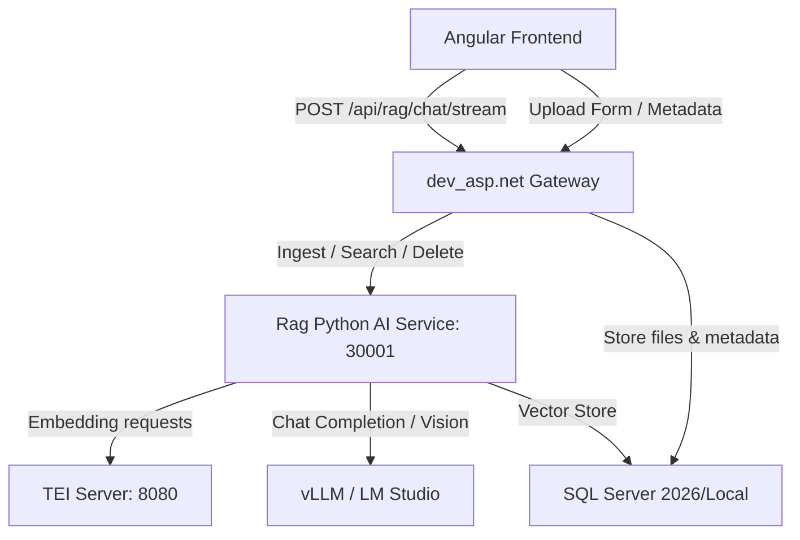

# Hướng dẫn Bàn giao & Triển khai Hệ thống RAG AI Service

Tài liệu này hướng dẫn chi tiết các bước thiết lập, cấu hình và chạy hệ thống dịch vụ RAG AI Service viết bằng Python FastAPI thay thế dịch vụ C# cũ, kết nối với cổng Gateway của dự án ASP.NET Core và giao diện Angular.

---

## 1. Thành phần Kiến trúc Hệ thống



---

## 2. Thiết lập Cơ sở Dữ liệu

Dự án sử dụng SQL Server để lưu trữ cả siêu dữ liệu tài liệu (từ phía C# Gateway) và các chunks vector embedding (từ phía Python).

### Bước 1: Tạo các bảng quản lý tài liệu phía Backend (Gateway)
Chạy file script SQL [migrations_rag.sql](file:///f:/BKU/Intern/dev_asp.net/migrations_rag.sql) trên cơ sở dữ liệu chính của bạn (ví dụ: `gAMSPro_BVB_V4_LIVE...`):

- **Bảng `RagDocuments`**: Lưu thông tin tài liệu, đường dẫn file vật lý trên ổ cứng của Gateway, trạng thái xử lý Ingestion (`Pending`, `Processing`, `Completed`, `Failed`) và thông tin người upload.
- **Bảng `RagDocumentRoles`**: Lưu cấu hình vai trò được truy cập đối với tài liệu có mức độ truy cập hạn chế (`Restricted`).

---

## 3. Thiết lập Rag Python AI Service

Dịch vụ Python nằm tại thư mục [F:\BKU\Intern\Rag](file:///F:/BKU/Intern/Rag).

### Cách 1: Chạy trực tiếp trên máy local (Windows/Linux)

#### Yêu cầu hệ thống:
1. Python 3.10 hoặc cao hơn.
2. Tesseract OCR (đã cài đặt gói ngôn ngữ tiếng Việt `vie`).
3. SQL Server ODBC Drivers (Driver 17 hoặc 18).

#### Các bước khởi chạy:
1. Mở terminal tại thư mục dự án Python:
   ```bash
   cd F:\BKU\Intern\Rag
   ```
2. Khởi tạo môi trường ảo và kích hoạt:
   ```bash
   python -m venv venv
   .\venv\Scripts\activate   # Trên Windows
   source venv/bin/activate  # Trên Linux
   ```
3. Cài đặt các thư viện phụ thuộc:
   ```bash
   pip install -r requirements.txt
   ```
4. Cấu hình các tham số môi trường trong file `.env` (nếu chưa có, tạo mới từ mẫu bên dưới).
5. Khởi chạy dịch vụ FastAPI:
   ```bash
   uvicorn app.main:app --host 0.0.0.0 --port 30001 --reload
   ```

### Cách 2: Triển khai bằng Docker Compose (Khuyên dùng khi chạy test)
Nếu muốn đóng gói đầy đủ cả dịch vụ TEI (Text Embeddings Inference) và Python AI Service:

1. Chạy lệnh build và khởi động các container:
   ```bash
   docker-compose up -d --build
   ```
2. Hệ thống sẽ tự động tải Docker Image của TEI, tải model `BAAI/bge-m3` và khởi chạy dịch vụ Python tại cổng `30001`.

### Cách 3: Triển khai bằng Kubernetes (k8s) (Dành cho môi trường Ubuntu k8s hiện tại)

Nếu máy chủ Ubuntu của bạn đang sử dụng **Kubernetes (k8s)** để điều phối các dịch vụ:

1. **Build Docker Image của Python AI Service trên node k8s**:
   ```bash
   docker build -t rag_api_python:latest .
   ```
2. **Gỡ bỏ Deployment của C# API Server cũ**:
   ```bash
   kubectl delete deployment api-server
   kubectl delete service api-server
   ```
3. **Áp dụng file manifest k8s mới**:
   Chúng ta đã tạo sẵn file [rag-python.yaml](file:///F:/BKU/Intern/Rag/rag-python.yaml) cấu hình đầy đủ biến môi trường và tự động kết hợp với Secret của SQL Server có sẵn (`ragapi-sql-secret`):
   ```bash
   kubectl apply -f rag-python.yaml
   ```
4. **Kiểm tra trạng thái triển khai**:
   ```bash
   kubectl get pods -l app=rag-python-service
   kubectl logs -f deployment/rag-python-service
   ```
   *Dịch vụ mới sẽ lắng nghe trực tiếp trên cổng NodePort `30001`, tương thích hoàn hảo với cấu hình Gateway hiện có trên Windows.*

---

## 4. Cấu hình Môi trường (`.env`)

Tạo file `.env` tại thư mục gốc dự án Python:
```env
# URL kết nối máy chủ Embedding (TEI)
TEI_URL=http://localhost:8080

# API Endpoint và Model của LLM (vLLM hoặc LM Studio)
UPRAG_LMSTUDIOENDPOINT=http://192.168.18.1:1224/v1
UPRAG_MODELID=qwen2.5-vl-7b-instruct
UPRAG_APIKEY=EMPTY

# Chuỗi kết nối SQL Server (Chứa kiểu dữ liệu VECTOR(1024))
# Lưu ý: Cần cấu hình đúng Driver, User và Password
SQLSERVER_CONNECTIONSTRING=Driver={ODBC Driver 18 for SQL Server};Server=localhost;Database=RagVectorDb;User Id=rag_api_user;Password=REPLACE_SA_PASSWORD;TrustServerCertificate=True;

# Cấu hình OCR & Vision
INGESTION_ENABLEOCR=true
INGESTION_ENABLEVISIONCAPTION=true
INGESTION_VISIONAPIURL=http://192.168.18.1:1224/v1/chat/completions
INGESTION_VISIONAPIKEY=lm-studio
INGESTION_VISIONMODEL=qwen2.5-vl-7b-instruct
INGESTION_TESSDATAPATH=C:\Program Files\Tesseract-OCR\tessdata
```

---

## 5. Xác minh Hoạt động

### 1. Kiểm tra Swagger UI của Python Service
Mở trình duyệt truy cập: [http://localhost:30001/docs](http://localhost:30001/docs)
- Các router chính cần hiển thị:
  - `GET /health`: Trạng thái máy chủ.
  - `POST /db/upload`: Ingest file (PDF, Word, Excel, PowerPoint, Image).
  - `POST /v1/chat/stream`: RAG Chat SSE.
  - `DELETE /db/documents/{backend_id}`: Xóa dữ liệu vector theo ID backend.

### 2. Kiểm tra C# Backend Gateway
- API Gateway sẽ đón nhận luồng upload, lưu file vào `wwwroot/uploads/rag/` và ghi nhận trạng thái của document trước khi đẩy luồng dữ liệu sang Python.
- API Chat `/api/rag/chat/stream` sẽ chuyển tiếp luồng POST và phân phối các token SSE trực tiếp về phía Angular thông qua cơ chế `Response.Body.FlushAsync()`.

### 3. Kiểm tra Angular Frontend
- Form tải tài liệu hỗ trợ tùy chọn hạn chế vai trò (`Restricted`) và cho phép gửi trống danh sách phân quyền kèm theo cảnh báo.
- Widget chat hỗ trợ Fetch Streaming đọc dữ liệu trực tiếp theo thời gian thực (SSE qua POST), không gặp lỗi font tiếng Việt và hỗ trợ tính năng gửi kèm ảnh chụp màn hình.
