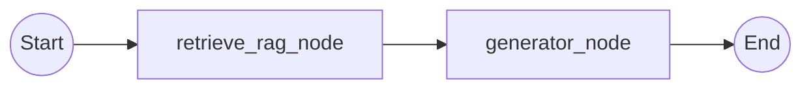

# AI Agent & Intent Routing Architecture

> 🌐 Language: **English** | [Tiếng Việt](AI_AGENT_ARCHITECTURE_vi.md)

This document provides a detailed technical reference for the **Rag Assistant** AI subsystem located under `app/ai`. It covers the system's architectural layers, the Supervisor Intent Router, the Fast Pipeline RAG graph, Dual Guardrails, Multimodal Vision processing, and the automated evaluation framework.

---

## Table of Contents

1. [Architectural Overview](#1-architectural-overview)
2. [Subsystem Directory Structure](#2-subsystem-directory-structure)
3. [Supervisor Intent Router (P2.1)](#3-supervisor-intent-router-p21)
4. [Fast Pipeline RAG Graph](#4-fast-pipeline-rag-graph)
5. [Dual Guardrails Subsystem](#5-dual-guardrails-subsystem)
6. [Multimodal Vision Mode](#6-multimodal-vision-mode)
7. [Automated Evaluation Framework (Eval)](#7-automated-evaluation-framework-eval)

---

## 1. Architectural Overview

The system combines a fast **Supervisor Intent Router** with an ultra-low-latency **Fast Pipeline RAG Graph** implemented via LangGraph, accompanied by comprehensive guardrails and RBAC access verification.

```
                    ┌──────────────────────────┐
                    │    User Query / Request  │
                    └────────────┬─────────────┘
                                 │
                                 ▼
                     ┌───────────────────────┐
                     │    INPUT GUARDRAIL    │
                     │  (Injection & Safety) │
                     └───────────┬───────────┘
                                 │
                                 ▼
                     ┌───────────────────────┐
                     │   SUPERVISOR ROUTER   │
                     │ (Rule-based Fast Path │
                     │  + Lightweight LLM)   │
                     └───────────┬───────────┘
                                 │
           ┌─────────────────────┴─────────────────────┐
           │ (intent: chitchat / out_of_scope)         │ (intent: rag)
           ▼                                           ▼
  ┌─────────────────┐                       ┌──────────────────────┐
  │ DIRECT STREAMER │                       │  FAST PIPELINE RAG   │
  │ (Instant reply  │                       │      LANGGRAPH       │
  │  adaptive SSE)  │                       └──────────┬───────────┘
  └─────────────────┘                                  │
                                    ┌──────────────────┴──────────────────┐
                                    ▼                                     ▼
                        ┌───────────────────────┐             ┌───────────────────────┐
                        │   retrieve_rag_node   │             │    generator_node     │
                        │ (Hybrid Search + RRF  │ ──────────> │  (Context synthesis   │
                        │  + Reranker + Expand) │             │  + Token streaming)   │
                        └───────────────────────┘             └──────────┬────────────┘
                                                                         │
                                                                         ▼
                                                              ┌───────────────────────┐
                                                              │   OUTPUT GUARDRAIL    │
                                                              │  (PII / Secret Mask)  │
                                                              └───────────────────────┘
```

---

## 2. Subsystem Directory Structure

```text
app/ai/
├── agent/                         # Agent workflows and intent routing
│   ├── agentic_rag/               # LangGraph Fast Pipeline
│   │   ├── graph/                 # StateGraph compiled workflow
│   │   ├── nodes/                 # retrieve_rag_node and generator_node
│   │   ├── prompts/               # Prompt registry and system templates
│   │   ├── state.py               # AgenticRagState TypedDict definition
│   │   └── tools/                 # Legacy tools & RBAC ContextVar helpers
│   │
│   ├── faq/                       # Fast atomic lookup agent
│   │   ├── graph/                 # StateGraph workflow
│   │   ├── prompts/               # Prompt templates
│   │   └── tools/                 # FAQ search tools
│   │
│   └── supervisor/                # Supervisor Intent Router
│       ├── classifier.py          # Rule-based fast path + Structured LLM fallback
│       ├── prompts/               # Router system prompts
│       └── schemas.py             # RouterOutput and IntentType schemas
│
├── eval/                          # Automated evaluation framework
│   ├── metrics.py                 # HitRateAtK, MRRAtK, CitationPrecision, ExactMatch
│   ├── report.py                  # Evaluation reporting and JSON summary
│   ├── runner.py                  # Evaluation execution engine
│   └── scorer.py                  # Aggregation and scoring logic
│
├── guardrails/                    # Input and Output Guardrails
│   ├── guardrail.py               # InputGuardrail and OutputGuardrail
│   └── schemas.py                 # GuardrailResult schemas
│
├── rag/                           # Retrieval-Augmented Generation subsystem
│   ├── chunking/                  # Hierarchical and semantic text splitters
│   ├── citation/                  # Citation deduplication and footer formatting
│   ├── embedding/                 # TeiEmbeddingService (BAAI/bge-m3 with LRU cache)
│   ├── ingestion/                 # Document ingestion pipeline & OCR extraction
│   ├── query/                     # Query contextualizer and rewriting utilities
│   ├── reranker/                  # FlashRank, CrossEncoder, Disabled, Factory
│   ├── retrieval/                 # Hybrid Retriever, Dynamic Top-K, Adjacent Expansion
│   └── text/                      # VietnameseNormalizer, acronym mappings, match normalizer
│
└── vision/                        # Multimodal processing
    ├── captioner.py               # Qwen-VL vision captioner
    └── ocr.py                     # Tesseract OCR extraction
```

---

## 3. Supervisor Intent Router (P2.1)

The Supervisor Intent Router (`app/ai/agent/supervisor/classifier.py`) evaluates incoming queries before invoking heavy RAG pipelines, minimizing unnecessary vector retrieval latency.

### 3.1 Two-Stage Routing Architecture

1. **Stage 1: Rule-Based Fast Path (0ms latency)**
   - **Chitchat Detection**: Matches greetings, thanks, compliments, or bot identity queries (e.g., "xin chào", "hello", "bạn là ai", "cảm ơn bạn"). Returns an immediate friendly response.
   - **Out-of-Scope Patterns**: Matches common off-topic categories using regular expressions (e.g., weather forecasts, cooking recipes, sports scores, lottery, jokes). Returns an informative scope reminder.
   - **Action & Domain Keywords**: Identifies business intent through keywords (e.g., "quy trình", "hướng dẫn", "chức năng", "thao tác", "nhập liệu") and action intent classifiers, instantly routing to `rag`.
   - **Query Length & Multi-turn Heuristic**: Queries with 6+ words or ongoing conversation history are automatically classified as `rag`.

2. **Stage 2: Lightweight Structured Output LLM Router (< 2.0s timeout)**
   - Activated only for short, ambiguous queries that bypass the fast-path rules.
   - Utilizes LangChain's `with_structured_output(RouterOutput)` with a strict 2.0-second timeout:
     ```python
     class IntentType(str, Enum):
         RAG = "rag"
         CHITCHAT = "chitchat"
         OUT_OF_SCOPE = "out_of_scope"

     class RouterOutput(BaseModel):
         intent: IntentType
         confidence: float = Field(default=0.9, ge=0.0, le=1.0)
         reasoning: str = Field(default="")
         rewritten_query: Optional[str] = None
     ```

---

## 4. Fast Pipeline RAG Graph

The core RAG workflow (`app/ai/agent/agentic_rag/graph/graph.py`) implements a streamlined 2-step pipeline without recursive agent loops, achieving optimal end-to-end latency (2-3 seconds).



### 4.1 State Definition (`AgenticRagState`)

The state schema (`app/ai/agent/agentic_rag/state.py`) strictly tracks active execution context:

```python
class AgenticRagState(TypedDict):
    messages: Annotated[List[BaseMessage], add_messages]
    user_query: str
    session_id: str
    user_roles: Optional[str]
    user_department: Optional[str]
    documents: List[str]
    citations: List[Dict[str, Any]]
    is_relevant: bool
    final_answer: str
    chat_history: Optional[List[Dict[str, Any]]]
    vision_context: Optional[str]
    selected_model: Optional[str]
    top_k: Optional[int]
```

### 4.2 Node 1: `retrieve_rag_node`
- Resolves user query from `user_query` or the latest human message.
- Executes `retriever.retrieve_context()` with Dynamic Top-K and RBAC filters.
- Safely unpacks document and citation results.
- Returns `{ "documents": docs, "citations": citations, "is_relevant": len(docs) > 0, "user_query": user_query }`.

### 4.3 Node 2: `generator_node`
- If no documents were found or `is_relevant` is False, returns a clean fallback notification.
- Formats retrieved chunks with indexed citation labels (`[Nguồn 1: filename, Trang X]`).
- Appends vision description context (if present).
- Injects multi-turn conversation history within configured window size.
- Invokes the selected LLM (`qwen2.5:3b`, `qwen2.5vl:7b`, `deepseek-r1:7b`, or `llama3.2:3b`) with streaming enabled.

---

## 5. Dual Guardrails Subsystem

Implemented in `app/ai/guardrails/guardrail.py`:

### 5.1 Input Guardrail
- Inspects input queries before any LLM processing.
- Detects prompt injection attempts (e.g., "ignore all previous instructions", "system prompt", "jailbreak").
- Detects toxic, abusive, or dangerous prompts.
- Returns `is_safe=False` and a predefined fallback message if violations are found.

### 5.2 Output Guardrail
- Inspects generated responses before sending to the client.
- Redacts leaked API keys, tokens, and personally identifiable information (PII).
- Detects severe hallucination flags.

---

## 6. Multimodal Vision Mode

The chat service supports interactive multimodal analysis:
- Users can toggle Vision Mode on or off per message turn.
- Direct clipboard pasting (`Ctrl + V`) allows users to attach screenshots into the chat input.
- Validates base64-encoded images:
  - Enforces a maximum of 3 images per request.
  - Enforces a maximum total size limit of 5 MB.
- Decoded image bytes are passed to `VisionService.describe_screenshot()` to extract textual content, UI elements, button labels, and system error dialogs, injecting them into the LLM context.

---

## 7. Automated Evaluation Framework (Eval)

Located in `app/ai/eval/`, providing standard benchmarks to continuously validate RAG quality:

- **Metrics**:
  - `HitRate@K`: Proportion of test cases where the ground-truth document is retrieved within the top K results.
  - `MRR@K (Mean Reciprocal Rank)`: Average reciprocal rank of the first relevant document.
  - `CitationPrecision`: Accuracy and relevance of generated citation references.
  - `ExactMatch`: String-level exact matching for deterministic evaluation queries.
- **Execution Script**:
  ```bash
  python scripts/run_eval.py
  ```
- **Telemetry**: Automatically integrates with Langfuse and LangSmith when tracing variables are configured.
