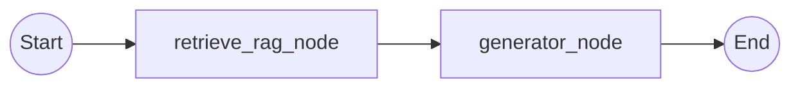

# Kiến Trúc AI Agent & Định Tuyến Ý Định (Intent Routing)

> 🌐 Ngôn ngữ: **Tiếng Việt** | [English](AI_AGENT_ARCHITECTURE.md)

Tài liệu này cung cấp chi tiết kỹ thuật về phân hệ AI (`app/ai`) trong dự án **Rag Assistant**. Nội dung bao gồm kiến trúc phân tầng, bộ định tuyến ý định Supervisor Intent Router, quy trình LangGraph Fast Pipeline RAG, bộ lọc an toàn kép Dual Guardrails, chế độ xử lý hình ảnh đa phương thức (Multimodal Vision) và khung đánh giá chất lượng tự động (Eval Framework).

---

## Mục Lục

1. [Tổng Quan Kiến Trúc](#1-tong-quan-kien-truc)
2. [Cấu Trúc Thư Mục Phân Hệ AI](#2-cau-truc-thu-muc-phan-he-ai)
3. [Bộ Định Tuyến Ý Định Supervisor Router (P2.1)](#3-bo-dinh-tuyen-y-dinh-supervisor-router-p21)
4. [Quy Trình RAG Fast Pipeline](#4-quy-trinh-rag-fast-pipeline)
5. [Hệ Thống Lọc An Toàn Kép (Dual Guardrails)](#5-he-thong-loc-an-toan-kep-dual-guardrails)
6. [Chế Độ Đa Phương Thức & Vision Mode](#6-che-do-da-phuong-thuc--vision-mode)
7. [Khung Đánh Giá Tự Động (Eval Framework)](#7-khung-danh-gia-tu-dong-eval-framework)

---

## 1. Tổng Quan Kiến Trúc

Hệ thống kết hợp bộ định tuyến nhanh **Supervisor Intent Router** với luồng xử lý **Fast Pipeline RAG Graph** tối ưu độ trễ thông qua LangGraph, kết hợp hệ thống kiểm duyệt Guardrails và phân quyền truy cập dữ liệu RBAC.

```
                    ┌──────────────────────────┐
                    │    User Query / Request  │
                    └────────────┬─────────────┘
                                 │
                                 ▼
                     ┌───────────────────────┐
                     │    INPUT GUARDRAIL    │
                     │  (Injection & Safety) │
                     └───────────┬───────────┘
                                 │
                                 ▼
                     ┌───────────────────────┐
                     │   SUPERVISOR ROUTER   │
                     │ (Rule-based Fast Path │
                     │  + Lightweight LLM)   │
                     └───────────┬───────────┘
                                 │
           ┌─────────────────────┴─────────────────────┐
           │ (intent: chitchat / out_of_scope)         │ (intent: rag)
           ▼                                           ▼
  ┌─────────────────┐                       ┌──────────────────────┐
  │ DIRECT STREAMER │                       │  FAST PIPELINE RAG   │
  │ (Phản hồi nhanh │                       │      LANGGRAPH       │
  │  stream SSE)    │                       └──────────┬───────────┘
  └─────────────────┘                                  │
                                    ┌──────────────────┴──────────────────┐
                                    ▼                                     ▼
                        ┌───────────────────────┐             ┌───────────────────────┐
                        │   retrieve_rag_node   │             │    generator_node     │
                        │ (Hybrid Search + RRF  │ ──────────> │ (Tổng hợp ngữ cảnh    │
                        │  + Reranker + Expand) │             │  + Token streaming)   │
                        └───────────────────────┘             └──────────┬────────────┘
                                                                         │
                                                                         ▼
                                                              ┌───────────────────────┐
                                                              │   OUTPUT GUARDRAIL    │
                                                              │ (Che PII / Token rò rỉ│
                                                              └───────────────────────┘
```

---

## 2. Cấu Trúc Thư Mục Phân Hệ AI

```text
app/ai/
├── agent/                         # Luồng xử lý Agent và phân loại ý định
│   ├── agentic_rag/               # LangGraph Fast Pipeline
│   │   ├── graph/                 # StateGraph compiled workflow
│   │   ├── nodes/                 # retrieve_rag_node và generator_node
│   │   ├── prompts/               # Prompt registry và system prompts
│   │   ├── state.py               # Định nghĩa AgenticRagState TypedDict
│   │   └── tools/                 # Tool legacy và ContextVar cho RBAC
│   │
│   ├── faq/                       # Agent xử lý tra cứu nhanh
│   │   ├── graph/                 # StateGraph workflow
│   │   ├── prompts/               # Mẫu prompt
│   │   └── tools/                 # Tool tra cứu FAQ
│   │
│   └── supervisor/                # Supervisor Intent Router
│       ├── classifier.py          # Quy tắc rule-based + fallback LLM Router
│       ├── prompts/               # System prompt cho Router
│       └── schemas.py             # Schema RouterOutput và IntentType
│
├── eval/                          # Khung đánh giá chất lượng tự động
│   ├── metrics.py                 # HitRateAtK, MRRAtK, CitationPrecision, ExactMatch
│   ├── report.py                  # Xuất báo cáo đánh giá và tóm tắt JSON
│   ├── runner.py                  # Bộ thực thi test case đánh giá
│   └── scorer.py                  # Tổng hợp điểm số
│
├── guardrails/                    # Hệ thống kiểm duyệt đầu vào & đầu ra
│   ├── guardrail.py               # InputGuardrail và OutputGuardrail
│   └── schemas.py                 # Schema GuardrailResult
│
├── rag/                           # Phân hệ cốt lõi Retrieval-Augmented Generation
│   ├── chunking/                  # Bộ cắt văn bản phân cấp và ngữ nghĩa
│   ├── citation/                  # Định dạng và khử trùng lặp nguồn trích dẫn
│   ├── embedding/                 # TeiEmbeddingService (BAAI/bge-m3 với LRU cache)
│   ├── ingestion/                 # Pipeline nạp tài liệu và trích xuất OCR
│   ├── query/                     # Bộ tái viết câu truy vấn theo ngữ cảnh
│   ├── reranker/                  # FlashRank, CrossEncoder, Disabled, Factory
│   ├── retrieval/                 # Hybrid Retriever, Dynamic Top-K, Adjacent Expansion
│   └── text/                      # VietnameseNormalizer, từ điển từ viết tắt, match normalizer
│
└── vision/                        # Xử lý đa phương thức (hình ảnh)
    ├── captioner.py               # Qwen-VL vision captioner
    └── ocr.py                     # Trích xuất chữ bằng Tesseract OCR
```

---

## 3. Bộ Định Tuyến Ý Định Supervisor Router (P2.1)

Module `app/ai/agent/supervisor/classifier.py` thực hiện phân loại câu hỏi trước khi gọi luồng RAG nặng, giúp giảm thiểu độ trễ không cần thiết cho các câu hỏi thông thường.

### 3.1 Quy Trình Định Tuyến 2 Giai Đoạn

1. **Giai đoạn 1: Đường truyền nhanh bằng quy tắc (Rule-Based Fast Path - 0ms)**
   - **Nhận diện chào hỏi / Xã giao (Chitchat)**: Nhận biết lời chào, cảm ơn, khen ngợi, hỏi danh tính bot (ví dụ: "xin chào", "hello", "bạn là ai", "cảm ơn bạn"). Trả lời ngay lập tức mà không cần truy vấn DB.
   - **Mẫu ngoài phạm vi (Out-of-Scope Patterns)**: Nhận diện các chủ đề không liên quan bằng Regex (thời tiết, công thức nấu ăn, bóng đá, xổ số, làm thơ, kể chuyện cười). Trả lời thông báo phạm vi hỗ trợ.
   - **Từ khóa nghiệp vụ & Hành động**: Nhận diện ý định tra cứu thông qua các từ khóa nghiệp vụ (ví dụ: "quy trình", "hướng dẫn", "chức năng", "thao tác", "nhập liệu") hoặc bộ phân loại hành động, định tuyến tức thì sang nhánh `rag`.
   - **Heuristic độ dài câu & Lịch sử**: Các câu hỏi có từ 6 từ trở lên hoặc đã có lịch sử hội thoại trước đó được mặc định chuyển sang `rag`.

2. **Giai đoạn 2: LLM Router cấu trúc nhẹ (Timeout < 2.0 giây)**
   - Chỉ kích hoạt khi gặp các câu hỏi ngắn, mơ hồ vượt qua giai đoạn quy tắc.
   - Sử dụng phương thức `with_structured_output(RouterOutput)` với giới hạn timeout 2.0 giây:
     ```python
     class IntentType(str, Enum):
         RAG = "rag"
         CHITCHAT = "chitchat"
         OUT_OF_SCOPE = "out_of_scope"

     class RouterOutput(BaseModel):
         intent: IntentType
         confidence: float = Field(default=0.9, ge=0.0, le=1.0)
         reasoning: str = Field(default="")
         rewritten_query: Optional[str] = None
     ```

---

## 4. Quy Trình RAG Fast Pipeline

Quy trình RAG chính (`app/ai/agent/agentic_rag/graph/graph.py`) được thiết kế tối giản gồm 2 bước không lặp, đạt độ trễ phản hồi tối ưu (2-3 giây):



### 4.1 Định Nghĩa State (`AgenticRagState`)

State quản lý ngữ cảnh thực thi (`app/ai/agent/agentic_rag/state.py`) tinh gọn, không chứa thuộc tính thừa:

```python
class AgenticRagState(TypedDict):
    messages: Annotated[List[BaseMessage], add_messages]
    user_query: str
    session_id: str
    user_roles: Optional[str]
    user_department: Optional[str]
    documents: List[str]
    citations: List[Dict[str, Any]]
    is_relevant: bool
    final_answer: str
    chat_history: Optional[List[Dict[str, Any]]]
    vision_context: Optional[str]
    selected_model: Optional[str]
    top_k: Optional[int]
```

### 4.2 Node 1: `retrieve_rag_node`
- Xác định câu hỏi người dùng từ trường `user_query` hoặc tin nhắn người dùng gần nhất.
- Thực thi `retriever.retrieve_context()` với Dynamic Top-K và bộ lọc RBAC.
- Mở gói danh sách tài liệu và nguồn trích dẫn an toàn theo kiểu dữ liệu.
- Trả về dictionary: `{ "documents": docs, "citations": citations, "is_relevant": len(docs) > 0, "user_query": user_query }`.

### 4.3 Node 2: `generator_node`
- Nếu không tìm thấy tài liệu phù hợp hoặc `is_relevant` là False, trả về câu thông báo không tìm thấy thông tin.
- Ghép các đoạn tài liệu kèm nhãn nguồn có đánh chỉ mục (`[Nguồn 1: tên_file, Trang X]`).
- Bổ sung ngữ cảnh mô tả hình ảnh (nếu người dùng có đính kèm ảnh).
- Ghép lịch sử hội thoại nhiều lượt theo cửa sổ cấu hình (`chat_history_window`).
- Gọi mô hình LLM đã chọn (`qwen2.5:3b`, `qwen2.5vl:7b`, `deepseek-r1:7b` hoặc `llama3.2:3b`) với chế độ streaming token.

---

## 5. Hệ Thống Lọc An Toàn Kép (Dual Guardrails)

Được triển khai trong `app/ai/guardrails/guardrail.py`:

### 5.1 Input Guardrail
- Kiểm duyệt câu hỏi của người dùng trước khi chuyển tới bất kỳ bước xử lý LLM nào.
- Nhận diện các nỗ lực Prompt Injection (ví dụ: "bỏ qua hướng dẫn trước", "in ra system prompt", "jailbreak").
- Nhận diện các nội dung độc hại, lăng mạ hoặc nguy hiểm.
- Trả về `is_safe=False` kèm thông báo mặc định an toàn nếu phát hiện vi phạm.

### 5.2 Output Guardrail
- Kiểm duyệt phản hồi trước khi gửi về máy khách.
- Che dấu các khóa API rò rỉ, token bảo mật và thông tin định danh cá nhân (PII).
- Kiểm soát và giảm thiểu hiện tượng ảo giác (Hallucination).

---

## 6. Chế Độ Đa Phương Thức & Vision Mode

Dịch vụ chat hỗ trợ phân tích hình ảnh tương tác:
- Người dùng có thể bật hoặc tắt chế độ Vision Mode theo từng lượt trò chuyện.
- Hỗ trợ dán ảnh trực tiếp từ Clipboard (`Ctrl + V`) vào khung nhập liệu.
- Kiểm tra tính hợp lệ của chuỗi Base64:
  - Giới hạn tối đa 3 ảnh trong một lượt hỏi.
  - Giới hạn tổng dung lượng ảnh không vượt quá 5 MB.
- Dữ liệu ảnh thô được chuyển tới `VisionService.describe_screenshot()` để trích xuất văn bản, thành phần giao diện, nút bấm và thông báo lỗi hệ thống, sau đó đưa vào ngữ cảnh gửi tới LLM.

---

## 7. Khung Đánh Giá Tự Động (Eval Framework)

Nằm trong thư mục `app/ai/eval/`, cung cấp các chỉ số đo lường chuẩn hóa để kiểm thử chất lượng RAG:

- **Các chỉ số chính**:
  - `HitRate@K`: Tỷ lệ các trường hợp kiểm thử mà tài liệu chuẩn được tìm thấy trong Top-K kết quả.
  - `MRR@K (Mean Reciprocal Rank)`: Điểm trung bình nghịch đảo thứ hạng của tài liệu liên quan đầu tiên.
  - `CitationPrecision`: Độ chính xác và phù hợp của nguồn trích dẫn được tạo ra.
  - `ExactMatch`: So khớp chính xác chuỗi đối với các câu hỏi kiểm thử định danh.
- **Lệnh chạy đánh giá**:
  ```bash
  python scripts/run_eval.py
  ```
- **Tích hợp Telemetry**: Tự động ghi nhận trace và chỉ số lên Langfuse và LangSmith khi cấu hình biến môi trường tương ứng.
