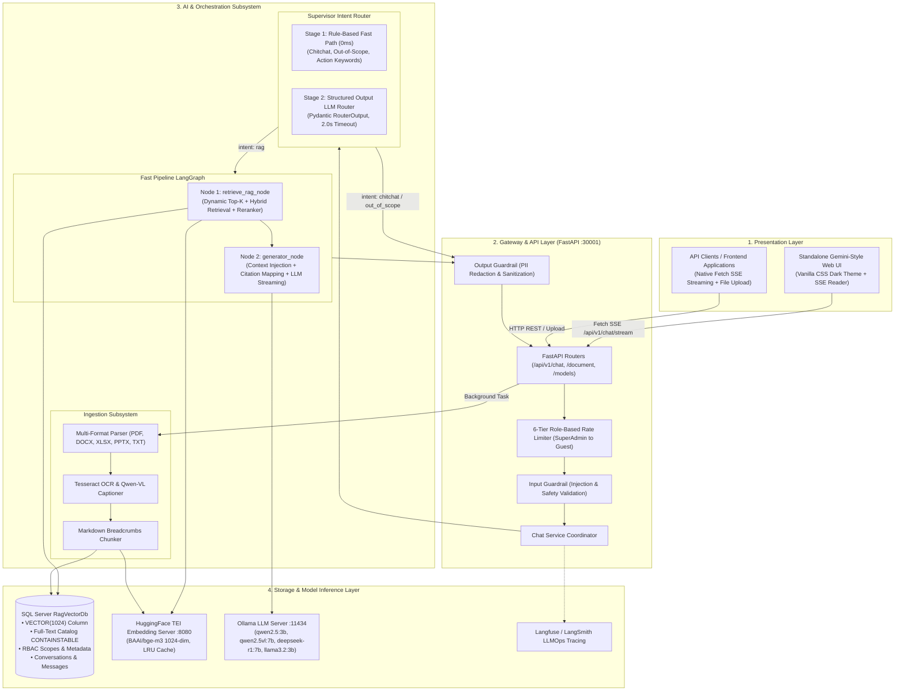

# System Architecture Guide
## Comprehensive Full-Stack & RAG AI Architecture Reference

> 🌐 Language: **English** | [Tiếng Việt](SYSTEM_ARCHITECTURE_GUIDE_vi.md)

This technical reference provides an in-depth blueprint of the system architecture, component responsibilities, design patterns, cross-layer data flows, and integration protocols across the full stack: the **FastAPI RAG AI Subsystem**, the **Gateway Layer**, the **Interactive Web UI / Frontend Clients**, and the **Database & Vector Inference Infrastructure**.

---

## Table of Contents

1. [High-Level Architecture & End-to-End Data Flow](#1-high-level-architecture--end-to-end-data-flow)
2. [AI Subsystem Architecture (FastAPI & LangGraph)](#2-ai-subsystem-architecture-fastapi--langgraph)
3. [Knowledge Ingestion & True Hybrid Search Pipeline](#3-knowledge-ingestion--true-hybrid-search-pipeline)
4. [Supervisor Intent Router & Fast Pipeline Workflow](#4-supervisor-intent-router--fast-pipeline-workflow)
5. [Frontend & Streaming UI Architecture](#5-frontend--streaming-ui-architecture)
6. [Security, Guardrails & RBAC Rate Limiting](#6-security-guardrails--rbac-rate-limiting)
7. [Integration Protocols & API Communication Matrix](#7-integration-protocols--api-communication-matrix)
8. [Production Deployment & Verification Standards](#8-production-deployment--verification-standards)

---

## 1. High-Level Architecture & End-to-End Data Flow

The system is organized into clean, modular layers following Domain-Driven Design (DDD) principles:



---

## 2. AI Subsystem Architecture (FastAPI & LangGraph)

The AI subsystem (`app/ai`) is structured cleanly to decouple orchestration, retrieval, guardrails, and model inference:

```text
app/ai/
├── agent/                         # Multi-agent coordination and workflows
│   ├── agentic_rag/               # LangGraph Fast Pipeline (retrieve_node -> generator_node)
│   ├── faq/                       # Fast atomic FAQ lookup agent
│   └── supervisor/                # Supervisor Intent Router (Rule-based + Structured LLM)
├── eval/                          # Automated evaluation benchmarks (HitRate, MRR, Precision)
├── guardrails/                    # Input and Output Guardrails
├── rag/                           # Core Retrieval-Augmented Generation Subsystem
│   ├── chunking/                  # Context-enriched hierarchical text splitters
│   ├── citation/                  # Deduplication and citation formatting
│   ├── embedding/                 # TeiEmbeddingService (BAAI/bge-m3, LRU cache)
│   ├── ingestion/                 # Background document ingestion pipeline
│   ├── query/                     # Query contextualization utilities
│   ├── reranker/                  # FlashRank, CrossEncoder, Disabled factory
│   ├── retrieval/                 # Hybrid Retriever, Dynamic Top-K, Adjacent Expansion
│   └── text/                      # Vietnamese text normalizer, acronym dictionary
└── vision/                        # Tesseract OCR & Qwen-VL Vision Captioner
```

---

## 3. Knowledge Ingestion & True Hybrid Search Pipeline

### 3.1 Document Ingestion Flow
1. **Multi-Format Extraction**: Ingestion pipeline reads PDF, DOCX, XLSX, PPTX, and TXT files. Images embedded in slides or pages are extracted and processed via Tesseract OCR and Vision captioning.
2. **Heading Context Breadcrumbs**: Chunks preserve hierarchical heading breadcrumbs (e.g., `[Ngữ cảnh: # Section 1 > ## Subsection A]`), preventing context loss when documents are split.
3. **Dense Vector Generation**: Chunks are embedded into 1024-dimensional dense vectors using `BAAI/bge-m3` via HuggingFace TEI with an LRU cache.
4. **Relational & Vector Storage**: Chunks and vectors are stored in SQL Server in the `RagDocumentChunks` table with `VECTOR(1024)` data types and Full-Text Search indexing.

### 3.2 True Hybrid Retrieval & Reciprocal Rank Fusion (RRF)
Queries are executed simultaneously across two search engines:
- **Vector Cosine Search**: Dense vector similarity search identifying semantic relationships.
- **Full-Text Search (FTS)**: Lexical keyword search using SQL Server `CONTAINSTABLE`.

The rankings from both engines are fused using **Reciprocal Rank Fusion (RRF)**:
$$RRF(d) = \sum_{m \in M} \frac{1}{k + r_m(d)}$$
where $k = 60$ and $r_m(d)$ is the document rank within search modality $m$.

### 3.3 Dynamic Top-K Retrieval
The retriever dynamically calculates the required number of chunks based on query complexity:
- **Specific queries** (single definitions, precise numbers, targeted buttons): Top-K = 3–5.
- **Exhaustive queries** (listings, comprehensive procedures, multi-step flows): Top-K = 10–15.
- **Complexity bonus/discount**: Dynamically adjusts chunk count based on question length and keyword richness.
- **Low-confidence boost**: Increases chunk count when intent classification confidence is below threshold.

### 3.4 Adjacent Sibling Chunk Expansion
When a chunk is selected from an exhaustive document, neighboring sibling chunks (`chunk_index ± window`) from the same source document are automatically fetched, preventing fragmentation across chunk boundaries.

### 3.5 Multi-Tier Reranking
A factory pattern provides flexible reranker engines configured via `RERANKER_TYPE`:
- `flashrank`: Lightweight local ONNX-based reranker for minimal latency.
- `cross_encoder`: Transformer model (e.g., `BAAI/bge-reranker-base`) for highest ranking accuracy.
- `disabled`: Bypasses reranking for near-zero reranking overhead.

---

## 4. Supervisor Intent Router & Fast Pipeline Workflow

### 4.1 Two-Stage Supervisor Intent Router
- **Stage 1 (Rule-Based Fast Path)**: Instant regular expression checks for greetings (`chitchat`), off-topic topics (`out_of_scope`), and domain action keywords (`rag`).
- **Stage 2 (Lightweight Structured Output LLM)**: For ambiguous queries, invokes LLM with `with_structured_output(RouterOutput)` and a strict 2.0-second timeout.

### 4.2 Fast Pipeline Execution (2-3s Latency)
- Replaces legacy multi-step tool-calling loops with a streamlined 2-node graph:
  $$\text{retrieve\_rag\_node} \longrightarrow \text{generator\_node} \longrightarrow \text{END}$$
- Emits real-time SSE events:
  - `chat_started`: Handshake event emitted once per stream.
  - `thinking`: Emitted during vision analysis or internal reasoning.
  - `token`: Streamed token-by-token.
  - `citations`: Emitted at stream completion with source metadata.
  - `chat_ended`: Signals stream completion.

---

## 5. Frontend & Streaming UI Architecture

The frontend client in `ui/` features a dark glassmorphic interface:
- **Server-Sent Events (SSE) Reader**: Uses the browser Native Fetch API with `ReadableStreamDefaultReader` to parse lines formatted as `event: ...\ndata: ...\n\n`.
- **Markdown & Code Highlighting**: Automatically formats Markdown, tables, LaTeX formulas, and syntax-highlighted code blocks.
- **Expandable Thinking Blocks**: Parses DeepSeek-R1 `<think>` tags into collapsible visual containers.
- **Interactive Citations Inspector**: Displays source filenames, page numbers, and exact excerpts.
- **Knowledge Base Modal**: Drag-and-drop document upload with real-time task polling and document deletion.

---

## 6. Security, Guardrails & RBAC Rate Limiting

### 6.1 Dual Guardrails
- **Input Guardrail**: Scans user prompts before processing, blocking prompt injection, jailbreaking, and abusive language.
- **Output Guardrail**: Sanitizes generated tokens, redacting leaked secrets, credentials, and personally identifiable information (PII).

### 6.2 SQL-Level RBAC Document Filtering
Every vector search query applies security filters directly in SQL:
- Documents with `accessScope = 'Public'` are accessible to all users.
- Documents with `accessScope = 'Restricted'` require matching user roles (`allowedRoles`) and department IDs (`departmentId`).

### 6.3 6-Tier Role-Based Rate Limiting
Controls request throughput per user role:
- SuperAdmin: Unlimited
- Admin: 120 requests/minute
- Manager: 60 requests/minute
- SeniorStaff: 40 requests/minute
- Staff: 30 requests/minute
- Guest: 10 requests/minute

---

## 7. Integration Protocols & API Communication Matrix

| Interface | Protocol | Endpoint | Request Payload | Response Format |
| --------- | -------- | -------- | --------------- | --------------- |
| Chat Streaming | HTTP POST | `/api/v1/chat/stream` | JSON (`message`, `images`, `model`, `enable_vision`) | SSE Stream (`chat_started`, `token`, `citations`, `chat_ended`) |
| Document Ingestion | HTTP POST Multipart | `/api/v1/document/upload` | Multipart form (`file`, `accessScope`, `allowedRoles`) | JSON (`task_id`, `status: processing`) |
| Ingestion Status | HTTP GET | `/api/v1/document/tasks/{taskId}` | None | JSON (`progress`, `status`, `chunks_created`) |
| Document Management | HTTP GET / DELETE | `/api/v1/document/documents` | None | JSON (`document_id`, `filename`, `chunk_count`) |
| Health Check | HTTP GET | `/api/v1/health` | None | JSON (`database: ok`, `tei: ok`, `llm: ok`) |

---

## 8. Production Deployment & Verification Standards

### 8.1 Verification Test Checklist
Before deploying changes to production, execute the automated verification test suite:

```bash
# 1. Verify architectural standards & registered endpoints
pytest tests/test_verify.py -v

# 2. Verify Guardrails, Evaluation metrics, and 6-Tier RBAC Rate Limiter
pytest tests/test_advanced_features.py -v

# 3. Verify Dynamic Top-K, Multi-tier Reranker, Normalizer, and Adjacent Chunk Expansion
pytest tests/test_rag_improvements.py -v

# 4. Run entire test suite
pytest tests/ -v
```

### 8.2 Production Readiness Best Practices
1. **Connection Pooling**: Configure SQL Server ODBC connection pooling with reasonable timeouts (`timeout=30`).
2. **Non-blocking Worker**: Ensure background tasks (document ingestion, conversation title generation) are spawned via `asyncio.create_task` with unhandled exception callbacks.
3. **Safe SSE Handshake**: Ensure `chat_started` event is always emitted before tokens, preventing frontend stream reader timeouts.
4. **Graceful Degradation**: When optional external services (such as OCR or Langfuse) are unavailable, fallback gracefully to text-only processing without failing the user request.
