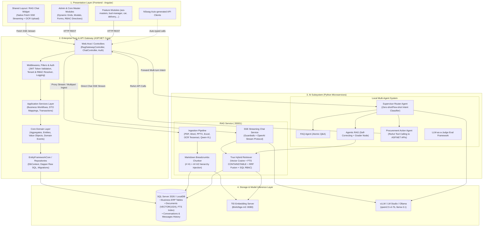

# 🏛️ CẨM NANG TOÀN TẬP: THIẾT KẾ KIẾN TRÚC HỆ THỐNG DOANH NGHIỆP
## (Enterprise Architecture Blueprint: ASP.NET Core Backend + Angular Frontend + FastAPI RAG + Multi-Agent AI System)

> **Mục đích tài liệu:** Đúc kết chi tiết toàn bộ cấu trúc thư mục, trách nhiệm từng tầng (Layer Responsibility), mẫu thiết kế (Design Patterns), quy chuẩn luồng dữ liệu (Data Flows) và cách thức tích hợp giữa 4 phân hệ lớn: **Backend C#**, **Frontend Angular**, **Dịch vụ RAG Ingestion/Hybrid Search** và **Hệ thống Đa tác tử Local Multi-Agent**. Bạn có thể dùng tài liệu này làm **khung tham chiếu chuẩn (Architectural Template)** cho bất kỳ dự án Enterprise Full-Stack + AI nào.

---

## 📑 MỤC LỤC
1. [Sơ Đồ Kiến Trúc Tổng Thể & Luồng Dữ Liệu Liên Phân Hệ](#1-sơ-đồ-kiến-trúc-tổng-thể--luồng-dữ-liệu-liên-phân-hệ)
2. [Phân Hệ 1: Backend Core & Gateway (ASP.NET Core / C#)](#2-phân-hệ-1-backend-core--gateway-aspnet-core--c)
3. [Phân Hệ 2: Frontend Single Page Application (Angular)](#3-phân-hệ-2-frontend-single-page-application-angular)
4. [Phân Hệ 3: RAG Service - Ingestion & True Hybrid Search (FastAPI Python)](#4-phân-hệ-3-rag-service---ingestion--true-hybrid-search-fastapi-python)
5. [Phân Hệ 4: Local Multi-Agent System (LangGraph Supervisor-Worker)](#5-phân-hệ-4-local-multi-agent-system-langgraph-supervisor-worker)
6. [Ma Trận Tích Hợp & Giao Thức Giao Tiếp (Communication Matrix)](#6-ma-trận-tích-hợp--giao-thức-giao-tiếp-communication-matrix)
7. [Quy Chuẩn Áp Dụng Khi Dựng Dự Án Mới (Production Checklist)](#7-quy-chuẩn-áp-dụng-khi-dựng-dự-án-mới-production-checklist)

---

## 1. Sơ Đồ Kiến Trúc Tổng Thể & Luồng Dữ Liệu Liên Phân Hệ



---

## 2. Phân Hệ 1: Backend Core & Gateway (ASP.NET Core / C#)

### 2.1. Cấu Trúc Thư Mục Chi Tiết
Backend được tổ chức theo kiến trúc **Clean Architecture / Domain-Driven Design (DDD)** kết hợp **Modular Monolith**:

```text
dev_asp.net/
├── GSOFTcore.gAMSPro.All.sln                 # Visual Studio Solution chứa toàn bộ dự án
├── src/
│   │
│   ├── GSOFTcore.gAMSPro.Core/               # [TẦNG 1: DOMAIN LAYER - Bất biến & Không phụ thuộc]
│   │   ├── Authorization/                    # Định nghĩa Roles, Permissions, AppPermissions
│   │   ├── Configuration/                    # AppSettingProvider, Host/Tenant Settings
│   │   ├── MultiTenancy/                     # Logic phân vùng Multi-Tenant (Tenant, Edition)
│   │   ├── Notifications/                    # Domain Notification Subsystem
│   │   └── Validation/                       # Custom Domain Validation Rules
│   │
│   ├── GSOFTcore.gAMSPro.Core.Shared/        # Enums, Consts dùng chung cho cả Client & Server
│   │   ├── AppConsts.cs
│   │   └── Authorization/AppPermissions.cs
│   │
│   ├── GSOFTcore.gAMSPro.Application/        # [TẦNG 2: APPLICATION LAYER - Triển khai Use Case]
│   │   ├── Authorization/                    # UserAppService, RoleAppService, PermissionAppService
│   │   ├── Common/                           # Base AppService, CommonLookupAppService
│   │   ├── Auditing/                         # AuditLogAppService ghi nhật ký hoạt động
│   │   ├── CustomDtoMapper.cs                # AutoMapper profile cấu hình map Entity <-> DTO
│   │   └── Rag/                              # Application Service điều phối RAG Gateway
│   │       ├── Dtos/                         # IngestDocumentDto, SearchDocumentDto, ChatStreamDto
│   │       └── IRagGatewayAppService.cs
│   │
│   ├── GSOFTcore.gAMSPro.Application.Shared/ # Contracts & Interfaces (DTOs, Interface Services)
│   │   └── [Module]/Dto/                     # Toàn bộ Input/Output DTO để NSwag sinh TypeScript
│   │
│   ├── GSOFTcore.gAMSPro.EntityFrameworkCore/# [TẦNG 3: INFRASTRUCTURE LAYER - Persistence]
│   │   ├── EntityFrameworkCore/
│   │   │   ├── gAMSProDbContext.cs           # DbContext chính, cấu hình Fluent API & Soft Delete
│   │   │   └── gAMSProDbContextFactory.cs    # Design-time Factory phục vụ `dotnet ef migrations`
│   │   ├── Migrations/                       # Lịch sử các file Migration C#
│   │   └── Repositories/                     # Generic Repositories & Custom Dapper Store Procedures
│   │
│   ├── GSOFTcore.gAMSPro.Web.Core/           # Core Web Subsystem (JWT Token, Auth Filter, SignalR)
│   │   ├── Authentication/JwtBearer/         # Cấu hình TokenValidationParameters, LifeTime
│   │   └── Configuration/AppConfigurationAccessor.cs
│   │
│   ├── GSOFTcore.gAMSPro.Web.Host/           # [TẦNG 4: PRESENTATION & GATEWAY HOST]
│   │   ├── Controllers/
│   │   │   ├── RagGatewayController.cs       # Reverse Streaming Proxy SSE & Ingestion Gateway
│   │   │   ├── ChatController.cs             # Quản lý Session & Message History
│   │   │   ├── UsersController.cs            # Quản lý User/Profile
│   │   │   └── HomeController.cs / UiController.cs
│   │   ├── Middlewares/                      # CorrelationIdMiddleware, GlobalExceptionHandler
│   │   ├── Startup/
│   │   │   ├── Program.cs
│   │   │   └── Startup.cs                    # DI Container, Swagger, CORS, Reverse Proxy Routing
│   │   ├── appsettings.json                  # ConnectionStrings, JWT Secret, Microservice URLs
│   │   └── wwwroot/                          # Static files, Upload temp buffer (`uploads/rag/`)
│   │
│   └── [Business_Domain_Modules]/            # [CÁC MODULE NGHIỆP VỤ ERP TÁCH RỜI]
│       ├── assMaster/                        # Quản lý Tài sản Cố định (Assets)
│       ├── budManager/                       # Quản lý Dự toán & Ngân sách (Budget)
│       ├── carMaster/                        # Quản lý Đội xe & Điều xe (Fleet Management)
│       ├── constMaster/                      # Quản lý Xây dựng cơ bản (Construction)
│       ├── delivery/                         # Giao nhận hàng hóa & Phiếu nhập/xuất
│       ├── materialStore/                    # Kho vật tư & Công cụ dụng cụ
│       ├── planMaster/                       # Kế hoạch Mua sắm & Đấu thầu
│       ├── trade/                            # Quản lý Hợp đồng & Nhà cung cấp
│       ├── vppMaster/                        # Quản lý Văn phòng phẩm & Cấp phát
│       └── warehouse/                        # Quản lý Kho bãi & Kiểm kê
```

### 2.2. Trách Nhiệm Từng Thành Phần & Code Pattern
1. **Controller Gateway (`RagGatewayController.cs`)**:
   - Nhận yêu cầu từ Angular, kiểm tra Claims/JWT Token để bóc tách: `UserId`, `UserName`, `Roles`, `Department`.
   - Forward yêu cầu sang FastAPI RAG Service qua stream HTTP POST.
   - Sử dụng cơ chế `Response.Body.FlushAsync()` để forward từng chunk token SSE về client ngay lập tức mà không bị đệm buffer.
   - Nhận file upload, lưu tạm vào `wwwroot/uploads/rag/`, lưu metadata vào bảng `RagDocuments`, sau đó gọi ngầm sang Python để Ingest.
2. **DTO & Contract Isolation**:
   - Mọi tương tác vào/ra đều qua DTO tại `GSOFTcore.gAMSPro.Application.Shared`. Tầng Presentation không bao giờ truy cập trực tiếp Entity để chống rò rỉ cấu trúc dữ liệu.

---

## 3. Phân Hệ 2: Frontend Single Page Application (Angular)

### 3.1. Cấu Trúc Thư Mục Chi Tiết
Frontend được tổ chức theo **Feature-Driven Modular Architecture**:

```text
dev_angular/
├── src/
│   ├── app/
│   │   ├── app.module.ts                     # Root Module (Khai báo Core imports & Providers)
│   │   ├── app-routing.module.ts             # Root Routing cấu hình Lazy Loading theo từng Module
│   │   ├── app.component.ts / .html          # Shell layout chính
│   │   │
│   │   ├── main/                             # [1. BUSINESS FEATURE MODULES (Lazy Loaded)]
│   │   │   ├── dashboard/                    # Dashboard chỉ số KPI nghiệp vụ
│   │   │   ├── main.module.ts
│   │   │   └── main-routing.module.ts
│   │   │
│   │   ├── admin/                            # [2. SYSTEM & ERP DOMAIN MODULES]
│   │   │   ├── admin.module.ts
│   │   │   ├── admin-routing.module.ts
│   │   │   ├── ass-masters/                  # UI Quản lý tài sản (Danh mục, Tăng/Giảm, Khấu hao)
│   │   │   ├── bud-manager/                  # UI Quản lý ngân sách & Hạn mức
│   │   │   ├── car-masters/                  # UI Quản lý & Điều phối xe
│   │   │   ├── plan-masters/                 # UI Kế hoạch mua sắm & Tờ trình
│   │   │   ├── warehouses/                   # UI Quản lý kho & Nhập xuất tồn
│   │   │   ├── vpp-master/                   # UI Cấp phát văn phòng phẩm
│   │   │   ├── common/                       # Các màn hình thiết lập hệ thống
│   │   │   │   ├── departments/              # Quản lý Phòng ban
│   │   │   │   ├── workflows/                # Cấu hình Quy trình phê duyệt
│   │   │   │   ├── authority/                # Phân quyền chức năng theo vai trò
│   │   │   │   └── upload-system-file/       # Màn hình quản lý tải tài liệu RAG & phân quyền
│   │   │   └── core/                         # UI Core components của Admin
│   │   │       ├── controls/                 # Custom Input, Dropdown, Datepicker, AutoComplete
│   │   │       ├── directives/               # PermissionDirective (`*hasPermission="X"`)
│   │   │       ├── modal/                    # Base Modal & Dialog Component
│   │   │       └── pipes/                    # Currency, DateTime, StatusColor Pipes
│   │   │
│   │   ├── shared/                           # [3. SHARED KERNEL & REUSABLE UI]
│   │   │   ├── common/                       # Module chung (Auth, Lookup, Localization)
│   │   │   ├── service-proxies/              # Auto-generated Typescript API Service Proxies (NSwag)
│   │   │   │   └── service-proxies.ts        # Chứa toàn bộ Typescript Classes & API Methods từ Backend
│   │   │   └── layout/                       # Layout Components (Header, Sidebar, Footer, Modals)
│   │   │       ├── topbar.component.ts       # Thanh công cụ trên cùng
│   │   │       ├── nav/                      # Menu điều hướng động theo quyền
│   │   │       └── rag-chat-widget/          # [WIDGET CHATBOT AI DOANH NGHIỆP]
│   │   │           ├── rag-chat-widget.component.ts   # Xử lý giao diện, phím tắt, render markdown
│   │   │           ├── rag-chat-widget.component.html # UI popup chat floating/docked, attachment preview
│   │   │           ├── rag-chat-widget.component.less # Styling hiện đại, dark/light theme, animations
│   │   │           ├── rag-chat.service.ts            # Quản lý Native Fetch SSE Streaming Reader
│   │   │           ├── rag-conversation.service.ts    # Lưu & chuyển đổi phiên hội thoại
│   │   │           └── rag-chat.config.ts             # Hằng số API URL & cấu hình SSE events
│   │   │
│   │   └── ultilities/                       # [4. CORE INFRASTRUCTURE UTILITIES]
│   │       ├── auth/                         # AuthGuard, PermissionGuard, TokenService
│   │       └── interceptors/                 # AuthHttpInterceptor (Gắn JWT), ErrorInterceptor
│   │
│   ├── assets/                               # Static Icons, Images, i18n JSON files
│   └── styles/                               # Global Less Styles, Design Tokens, Typography
```

### 3.2. Code Pattern Tiêu Biểu: Native Fetch SSE Streaming trong Angular
Trong [rag-chat.service.ts](file:///f:/BKU/Nam%203/Intern/Intern/dev_angular/src/app/shared/layout/rag-chat-widget/rag-chat.service.ts), thay vì dùng `HttpClient` bị buffer toàn bộ body, ta sử dụng Native Fetch API:
```typescript
async streamChat(payload: ChatPayload, onToken: (token: string) => void, onCitations: (c: any) => void) {
    const response = await fetch(`${this.apiUrl}/api/rag/chat/stream`, {
        method: 'POST',
        headers: { 'Content-Type': 'application/json', 'Authorization': `Bearer ${this.token}` },
        body: JSON.stringify(payload)
    });
    const reader = response.body?.getReader();
    const decoder = new TextDecoder('utf-8');
    while (reader) {
        const { done, value } = await reader.read();
        if (done) break;
        const textChunk = decoder.decode(value, { stream: true });
        // Phân tích SSE lines: "event: token \n data: {...}"
        this.parseSseChunk(textChunk, onToken, onCitations);
    }
}
```

---

## 4. Phân Hệ 3: RAG Service - Ingestion & True Hybrid Search (FastAPI Python)

### 4.1. Cấu Trúc Thư Mục Chi Tiết
Dịch vụ RAG được tổ chức theo chuẩn **Domain-Driven Design (DDD) Microservice**:

```text
Rag/
├── app/
│   ├── main.py                               # FastAPI App: CORS, Middlewares, OpenAPI Specs, Router Registry
│   ├── lifespan.py                           # Hook khởi động: Kiểm tra DB, Pre-warm model, Auto-create Table
│   ├── config.py                             # Pydantic Settings đọc cấu hình từ .env
│   ├── dependencies.py                       # Global FastAPI Dependency Injectors
│   │
│   ├── core/                                 # [1. INFRASTRUCTURE & SETTINGS]
│   │   ├── config.py                         # Pydantic BaseSettings (DB connection, URLs, Model Names)
│   │   ├── database.py                       # SQLAlchemy SessionLocal, Engine & Connection Pooling
│   │   └── middleware.py                     # API Key Middleware, Execution Timing, Structured Logging
│   │
│   ├── ai/                                   # [2. AI & RAG ALGORITHMIC SUBSYSTEM]
│   │   ├── guardrails/                       # Bảo mật AI
│   │   │   └── guardrail.py                  # InputGuardrail (Prompt Injection), OutputGuardrail (Secret Filter)
│   │   │
│   │   ├── vision/                           # Xử lý Thị giác máy tính & OCR
│   │   │   ├── ocr_service.py                # Tesseract OCR engine bóc tách chữ từ ảnh scan
│   │   │   ├── vision_service.py             # Vision Model Client (Qwen2.5-VL) mô tả ảnh UI/chụp màn hình
│   │   │   └── image_utils.py                # Tiền xử lý ảnh: Crop, Resize, Grayscale, Base64
│   │   │
│   │   └── rag/                              # Lõi RAG Subsystem
│   │       ├── text/
│   │       │   └── normalizer.py             # Chuẩn hóa tiếng Việt, loại bỏ ký tự rác, mở rộng từ viết tắt
│   │       ├── chunking/
│   │       │   └── splitter.py               # Markdown Breadcrumbs Chunking (# H1 > ## H2 context prefix)
│   │       ├── embedding/
│   │       │   └── service.py                # TeiEmbeddingService (Giao tiếp TEI bge-m3, Batching, Cache)
│   │       ├── citation/
│   │       │   └── helper.py                 # Trích xuất số trang, file gốc, tạo footer footnote nguồn
│   │       ├── reranker/                     # Reranker Factory (FlashRank Cross-Encoder hoặc Passthrough)
│   │       │   ├── factory.py, base.py, flashrank_reranker.py
│   │       ├── retrieval/
│   │       │   └── retriever.py              # VectorRetriever điều phối tìm kiếm đa tầng
│   │       └── ingestion/                    # Hệ thống bóc tách & nạp tài liệu
│   │           ├── extractor.py              # FileTextExtractor điều hướng theo đuôi file
│   │           ├── procedure_extractor.py    # Nhận diện & bảo toàn cấu trúc quy trình các bước (Step 1, 2,...)
│   │           ├── pipeline.py               # IngestionPipeline (Background Task nạp vector vào DB)
│   │           └── parsers/                  # Parsers chuyên biệt cho từng định dạng
│   │               ├── base.py               # BaseDocumentParser abstract class
│   │               ├── pdf_parser.py         # PyMuPDF parser + OCR fallback cho trang dạng scan
│   │               ├── word_parser.py        # python-docx parser trích xuất bảng biểu & headings
│   │               ├── pptx_parser.py        # python-pptx parser theo từng slide
│   │               ├── tabular_parser.py     # openpyxl / pandas parser cho Excel & CSV
│   │               ├── image_parser.py       # Parser cho ảnh tài liệu / biểu mẫu
│   │               └── text_parser.py        # Parser cho Markdown / TXT
│   │
│   ├── modules/                              # [3. DOMAIN MODULES - Xử lý nghiệp vụ & Data Access]
│   │   ├── chat/                             # Nghiệp vụ Chat & Hội thoại
│   │   │   ├── api/v1/
│   │   │   │   ├── endpoints.py              # POST /api/v1/chat/stream, GET /conversations
│   │   │   │   └── schemas.py                # ChatRequest, ChatImageInput, ChatStreamResponse
│   │   │   ├── model.py                      # SQLAlchemy Models: RagConversation, RagMessage
│   │   │   ├── repository.py                 # ChatRepository: Lưu tin nhắn, cập nhật tiêu đề
│   │   │   └── service.py                    # ChatService: Điều phối Guardrail, Retrieval, Stream SSE
│   │   │
│   │   ├── document/                         # Nghiệp vụ Quản lý Tài liệu & Vector Store
│   │   │   ├── api/v1/
│   │   │   │   ├── endpoints.py              # POST /upload, GET /documents, DELETE /{id}
│   │   │   │   └── schemas.py                # DocumentUploadResponse, IngestTaskStatus
│   │   │   ├── model.py                      # SQLAlchemy Models: RagDocument, RagDocumentRole, IngestionTask
│   │   │   ├── repository.py                 # DocumentRepository (True Hybrid Search Cosine + FTS + RRF)
│   │   │   └── service.py                    # DocumentService điều phối Background Ingestion
│   │   │
│   │   └── health/                           # Nghiệp vụ Health Check phục vụ Kubernetes Readiness/Liveness Probes
│   │       └── api/v1/endpoints.py           # GET /health, GET /api/v1/health
│   │
│   └── routers/                              # [4. ROUTER REGISTRY & COMPATIBILITY LAYER]
│       ├── dependencies.py                   # Singleton Factory Getters (get_chat_service, get_retriever,...)
│       └── router.py                         # Gộp v1 endpoints và alias tương thích ngược (/db/*, /v1/*)
│
├── configs/                             # Quản lý dependencies & file cấu hình (pyproject.toml, requirements.txt, .env.example)
├── infra/                               # Triển khai Docker (Ollama + TEI) & Kubernetes manifests
│   ├── docker/                          # Dockerfile, docker-compose.yml
│   └── k8s/                             # rag-python.yaml
├── scripts/                             # Script tự động hóa deploy & môi trường (deploy_python.ps1, .env.ps1)
├── database/                            # DDL Script khởi tạo bảng Documents, Vector & FTS Index (setup.sql, Db.bak)
├── tests/                               # Suite test kiến trúc 6 bước tự động (test_verify.py)
├── docs/                                # Tài liệu hướng dẫn & kiến trúc hệ thống
└── .env                                 # Biến môi trường local
```

---

## 5. Phân Hệ 4: Local Multi-Agent System (LangGraph Supervisor-Worker)

### 5.1. Cấu Trúc Thư Mục Chi Tiết
Hệ thống Multi-Agent được tổ chức theo **Supervisor-Worker Pattern** kết hợp **ReAct Tool-Calling Loops**:

```text
Local AI Agent/
├── app/
│   ├── main.py                               # FastAPI Entrypoint cho Agent Service
│   ├── lifespan.py                           # Khởi tạo Checkpointer, Redis Memory & LLM Clients
│   │
│   ├── ai/                                   # [LÕI ORCHESTRATION & AGENT SUB-SYSTEM]
│   │   ├── AI_ARCHITECTURE.md                # Tài liệu kiến trúc Multi-Agent
│   │   │
│   │   ├── agent/                            # [CÁC AGENT ĐỘC LẬP THEO CHUYÊN MÔN]
│   │   │   │
│   │   │   ├── supervisor/                   # [1. SUPERVISOR AGENT - ĐIỀU PHỐI & PHÂN LOẠI INTENT]
│   │   │   │   ├── graph/                    # Workflow phân loại bằng LangGraph StateGraph
│   │   │   │   ├── nodes/                    # classify_intent_node (Zero-shot / Few-shot Router)
│   │   │   │   ├── prompts/v1/system.md      # System Prompt phân biệt 4 loại Intent
│   │   │   │   ├── schemas.py                # Enum IntentType (faq, rag, procurement, fallback)
│   │   │   │   └── state.py                  # SupervisorState (Input messages, Target agent)
│   │   │   │
│   │   │   ├── faq/                          # [2. FAQ AGENT - TRA CỨU THỦ TỤC NHANH]
│   │   │   │   ├── graph/                    # Quick-lookup Graph
│   │   │   │   ├── prompts/                  # FAQ System Prompts
│   │   │   │   └── tools/                    # Tool tìm kiếm câu hỏi thường gặp
│   │   │   │
│   │   │   ├── agentic_rag/                  # [3. AGENTIC RAG - TRA CỨU QUY CHẾ CHUYÊN SÂU]
│   │   │   │   ├── graph/                    # Self-Correction Loop (Agent -> Tools -> Grader -> Retry)
│   │   │   │   ├── nodes/                    # rag_agent_node, grader_node (Chấm điểm độ liên quan), generator_node
│   │   │   │   ├── prompts/                  # System Prompts cho từng Node
│   │   │   │   ├── tools/                    # Vector Hybrid Search Tools
│   │   │   │   ├── schemas.py                # GradeOutput (is_relevant: bool)
│   │   │   │   └── state.py                  # AgenticRagState (messages, retry_count, is_relevant)
│   │   │   │
│   │   │   ├── procurement/                  # [4. PROCUREMENT AGENT - REACT ACTION CHO ERP]
│   │   │   │   ├── graph/                    # ReAct Execution Graph
│   │   │   │   ├── nodes/                    # action_agent_node, tool_executor_node
│   │   │   │   ├── prompts/                  # ReAct ERP Policy Prompt
│   │   │   │   ├── tools/                    # Toolset gọi API ASP.NET Core
│   │   │   │   │   ├── client.py             # HTTP Client kết nối Gateway Backend
│   │   │   │   │   ├── plan_detail_tool.py   # Tra cứu hạn mức ngân sách & kế hoạch mua sắm
│   │   │   │   │   ├── po_master_tool.py     # Tra cứu đơn đặt hàng PO & nhà cung cấp
│   │   │   │   │   ├── request_doc_tool.py   # Tra cứu tờ trình mua sắm
│   │   │   │   │   ├── create_request_doc_tool.py  # Tạo mới tờ trình mua sắm từ chat
│   │   │   │   │   ├── submit_request_doc_tool.py  # Gửi duyệt tờ trình lên cấp quản lý
│   │   │   │   │   └── error_handler.py      # Xử lý lỗi & giải thích thân thiện
│   │   │   │   └── state.py                  # ProcurementState
│   │   │   │
│   │   │   └── fallback/                     # [5. FALLBACK AGENT - CHITCHAT & TỪ CHỐI AN TOÀN]
│   │   │       ├── graph/
│   │   │       └── prompts/                  # Chitchat & Safe Refusal Prompts
│   │   │
│   │   ├── memory/                           # [BỘ NHỚ HỘI THOẠI & CONTEXT REWRITE]
│   │   │   └── conversation/
│   │   │       └── schemas.py                # ContextualizedQuery Pydantic Schema
│   │   │
│   │   ├── eval/                             # [KHUNG ĐÁNH GIÁ TỰ ĐỘNG LLM-AS-A-JUDGE]
│   │   │   ├── metrics.py                    # ExactMatch, NumericMinValue, LLMJudgeMetric
│   │   │   ├── runner.py                     # Trình chạy đánh giá bộ Benchmark Dataset
│   │   │   ├── scorer.py                     # Chấm điểm tổng hợp (Faithfulness, Relevance)
│   │   │   └── report.py                     # Xuất báo cáo HTML Dashboard & Rich Terminal Table
│   │   │
│   │   └── orchestration/                    # StateGraph liên kết toàn bộ Multi-Agent
│   │
│   ├── llmops/                               # [QUẢN LÝ MÔ HÌNH & TRACING]
│   │   ├── factory.py                        # ModelFactory (Khởi tạo kết nối vLLM, LM Studio, Ollama)
│   │   └── langsmith.py                      # Tích hợp OpenTelemetry / LangSmith Tracing
│   │
│   └── tests/                                # Bộ Unit Test & Benchmark Test Cases
```

---

## 6. Ma Trận Tích Hợp & Giao Thức Giao Tiếp (Communication Matrix)

| Luồng Nghiệp Vụ | Nguồn Gọi (Caller) | Đích Nhận (Callee) | Giao thức / Format | Trách nhiệm chính |
| :--- | :--- | :--- | :--- | :--- |
| **1. Chat Stream SSE** | Angular Chat Widget | ASP.NET Gateway | `POST /api/rag/chat/stream` (SSE) | Xác thực JWT, lấy Roles/Dept, forward stream về UI |
| **2. Chat Forwarding** | ASP.NET Gateway | FastAPI RAG Service | `POST /v1/chat/stream` (SSE) | Hybrid Search, Guardrails, gọi LLM, stream token |
| **3. Ingestion Sync** | Angular Admin | ASP.NET Gateway | `POST /api/rag/documents/upload` | Lưu file vật lý, lưu metadata CSDL, kích hoạt Ingest |
| **4. Ingestion Task** | ASP.NET Gateway | FastAPI RAG Service | `POST /db/upload` (Multipart) | Background Task: Parse $\to$ Chunk $\to$ Embed $\to$ Upsert |
| **5. Embedding** | FastAPI RAG Service | TEI Server (:8080) | `POST /embed` (JSON Array) | Sinh vector embedding 1024 chiều (model `bge-m3`) |
| **6. Multi-Agent Route**| FastAPI RAG Service | Local AI Agent | Internal LangGraph Invocation | Supervisor phân loại Intent $\to$ kích hoạt Worker |
| **7. ReAct Tool Call** | Procurement Agent | ASP.NET Gateway | `GET/POST /api/services/app/*` | Đọc/ghi dữ liệu ERP (Tờ trình, PO, Dự toán) |

---

## 7. Quy Chuẩn Áp Dụng Khi Dựng Dự Án Mới (Production Checklist)

Khi khởi tạo một dự án mới theo mô hình kiến trúc này, hãy thực hiện theo đúng các bước sau:

### ✅ Bước 1: Thiết lập CSDL (Database First)
1. Tạo bảng nghiệp vụ quan hệ trong SQL Server hoặc PostgreSQL.
2. Thêm bảng `Documents` hỗ trợ Vector:
   - Trong SQL Server 2026: Dùng cột `Embedding VECTOR(1024)` và `CONTAINSTABLE` cho FTS.
   - Trong PostgreSQL: Dùng extension `pgvector` với kiểu `vector(1024)`.
3. Bổ sung các cột metadata RBAC: `accessScope` (`Public`/`Restricted`) và `allowedRoles` (dạng JSON Array).

### ✅ Bước 2: Dựng Backend Gateway (C# ASP.NET Core)
1. Thiết lập 4 tầng Clean Architecture: `Core`, `Application`, `EntityFrameworkCore`, `Web.Host`.
2. Viết `RagGatewayController.cs` triển khai kỹ thuật **Streaming Reverse Proxy** (`Response.Body.FlushAsync()`).
3. Cấu hình NSwag để tự động sinh file `service-proxies.ts` sang Frontend mỗi khi build.

### ✅ Bước 3: Dựng Frontend SPA (Angular)
1. Chia các module theo cấu trúc: `app/main` (nghiệp vụ), `app/admin` (quản trị), `app/shared` (dùng chung).
2. Tích hợp Component `rag-chat-widget` sử dụng Native `fetch()` kèm Stream Reader để nhận token thời gian thực.

### ✅ Bước 4: Dựng RAG Service (FastAPI)
1. Áp dụng chuẩn **Markdown Breadcrumbs Chunking**: Luôn gán ngữ cảnh phân cấp `# H1 > ## H2` vào chunk.
2. Cài đặt thuật toán **True Hybrid Search**: Vector Cosine Search + FTS Rank hợp nhất bằng **RRF (Reciprocal Rank Fusion)**.
3. Thiết lập Guardrails đầu vào (chặn Prompt Injection) và đầu ra (chặn lộ Key bí mật).

### ✅ Bước 5: Dựng Multi-Agent Orchestration (LangGraph)
1. Dựng `Supervisor Agent` với System Prompt phân loại Intent rõ ràng.
2. Tách nhỏ các tác vụ thành các Agent độc lập (FAQ Agent, Deep RAG Agent, Action ERP Agent).
3. Luôn xây dựng bộ `eval` (LLM-as-a-Judge) để đánh giá tự động trước khi triển khai môi trường Production.
