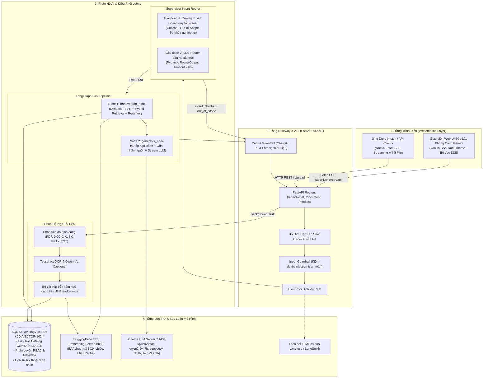

# Hướng Dẫn Kiến Trúc Hệ Thống Toàn Diện
## Tài Liệu Tham Chiếu Kiến Trúc Full-Stack & RAG AI

> 🌐 Ngôn ngữ: **Tiếng Việt** | [English](SYSTEM_ARCHITECTURE_GUIDE.md)

Tài liệu này cung cấp bản thiết kế chi tiết về kiến trúc hệ thống, trách nhiệm của từng thành phần, các mẫu thiết kế (Design Patterns), luồng dữ liệu liên tầng và giao thức tích hợp xuyên suốt: **Phân hệ RAG AI FastAPI**, **Tầng Gateway**, **Giao diện Web UI / Máy khách**, cùng **Hạ tầng Cơ sở Dữ liệu & Mô hình AI**.

---

## Mục Lục

1. [Kiến Trúc Tổng Thể & Luồng Dữ Liệu](#1-kien-truc-tong-the--luong-du-lieu)
2. [Kiến Trúc Phân Hệ AI (FastAPI & LangGraph)](#2-kien-truc-phan-he-ai-fastapi--langgraph)
3. [Pipeline Nạp Tri Thức & Tìm Kiếm Lai True Hybrid Search](#3-pipeline-nap-tri-thuc--tim-kiem-lai-true-hybrid-search)
4. [Bộ Định Tuyến Ý Định Supervisor Router & Fast Pipeline](#4-bo-dinh-tuyen-y-dinh-supervisor-router--fast-pipeline)
5. [Kiến Trúc Giao Diện Web UI & Streaming Real-Time](#5-kien-truc-giao-dien-web-ui--streaming-real-time)
6. [Hệ Thống An Toàn, Guardrails & Phân Quyền RBAC](#6-he-thong-an-toan-guardrails--phan-quyen-rbac)
7. [Giao Thức Tích Hợp & Ma Trận Giao Tiếp API](#7-giao-thuc-tich-hop--ma-tran-giao-tiep-api)
8. [Tiêu Chuẩn Kiểm Thử & Sẵn Sàng Vận Hành Production](#8-tieu-chuan-kiem-thu--san-sang-van-hanh-production)

---

## 1. Kiến Trúc Tổng Thể & Luồng Dữ Liệu

Hệ thống được tổ chức thành các tầng mô-đun rõ ràng theo nguyên tắc thiết kế hướng miền (Domain-Driven Design - DDD):



---

## 2. Kiến Trúc Phân Hệ AI (FastAPI & LangGraph)

Phân hệ AI (`app/ai`) được tách biệt thành các mô-đun độc lập, không phụ thuộc chéo:

```text
app/ai/
├── agent/                         # Luồng điều phối và phân loại ý định
│   ├── agentic_rag/               # LangGraph Fast Pipeline (retrieve_node -> generator_node)
│   ├── faq/                       # Agent tra cứu FAQ nhanh
│   └── supervisor/                # Supervisor Intent Router (Rule-based + Structured LLM)
├── eval/                          # Khung đánh giá tự động (HitRate, MRR, Precision)
├── guardrails/                    # Bộ lọc kiểm duyệt Input & Output
├── rag/                           # Phân hệ cốt lõi Retrieval-Augmented Generation
│   ├── chunking/                  # Bộ cắt văn bản phân cấp bảo toàn ngữ cảnh
│   ├── citation/                  # Định dạng và khử trùng lặp nguồn trích dẫn
│   ├── embedding/                 # TeiEmbeddingService (BAAI/bge-m3, LRU cache)
│   ├── ingestion/                 # Pipeline nạp tài liệu chạy ngầm
│   ├── query/                     # Bộ tái viết và làm rõ ngữ cảnh câu hỏi
│   ├── reranker/                  # Factory Reranker: FlashRank, CrossEncoder, Disabled
│   ├── retrieval/                 # Hybrid Retriever, Dynamic Top-K, Adjacent Expansion
│   └── text/                      # Bộ chuẩn hóa tiếng Việt, từ điển từ viết tắt
└── vision/                        # Tesseract OCR & Qwen-VL Vision Captioner
```

---

## 3. Pipeline Nạp Tri Thức & Tìm Kiếm Lai True Hybrid Search

### 3.1 Quy Trình Nạp Tài Liệu (Ingestion Flow)
1. **Trích Xuất Đa Định Dạng**: Hỗ trợ tập tin PDF, DOCX, XLSX, PPTX và TXT. Hình ảnh nhúng trong tài liệu được trích xuất và đưa qua Tesseract OCR cùng mô hình thị giác Vision Captioner.
2. **Bảo Toàn Ngữ Cảnh Tiêu Đề (Breadcrumbs)**: Mỗi đoạn trích xuất đều được gắn kèm ngữ cảnh phân cấp tiêu đề (ví dụ: `[Ngữ cảnh: # Mục 1 > ## Tiểu mục A]`), loại bỏ hiện tượng mất ngữ cảnh khi phân mảnh văn bản.
3. **Tạo Vector Dense**: Chuyển đổi văn bản thành vector 1024 chiều bằng mô hình `BAAI/bge-m3` thông qua HuggingFace TEI với bộ nhớ đệm LRU Cache.
4. **Lưu Trữ Quan Hệ & Vector**: Dữ liệu đoạn và vector được lưu vào bảng `RagDocumentChunks` trong SQL Server với kiểu dữ liệu `VECTOR(1024)` cùng chỉ mục Full-Text Search.

### 3.2 Tìm Kiếm Lai True Hybrid Search & Hợp Nhất RRF
Mỗi câu truy vấn được thực thi đồng thời trên 2 công cụ tìm kiếm:
- **Vector Cosine Search**: Tìm kiếm độ tương đồng vector dense để nắm bắt ngữ nghĩa sâu xa.
- **Full-Text Search (FTS)**: Tìm kiếm từ khóa chính xác thông qua hàm `CONTAINSTABLE` của SQL Server.

Kết quả thứ hạng của cả hai công cụ được kết hợp thông qua thuật toán **Reciprocal Rank Fusion (RRF)**:
$$RRF(d) = \sum_{m \in M} \frac{1}{k + r_m(d)}$$
với hằng số chuẩn $k = 60$ và $r_m(d)$ là thứ hạng của tài liệu $d$ trong phương thức tìm kiếm $m$.

### 3.3 Truy Xuất Động Dynamic Top-K
Hệ thống tự động tính toán số lượng chunk tối ưu dựa trên độ phức tạp của câu hỏi:
- **Câu hỏi cụ thể** (hỏi 1 người, 1 con số, 1 nút bấm, định nghĩa đơn): Top-K = 3–5.
- **Câu hỏi tổng hợp / Liệt kê** (hỏi quy trình nhiều bước, danh sách đầy đủ): Top-K = 10–15.
- **Cộng/giảm theo độ phức tạp**: Điều chỉnh linh hoạt theo độ dài câu hỏi và số lượng từ khóa.
- **Tăng cường khi độ tin cậy thấp**: Tự động lấy thêm chunk khi điểm phân loại intent dưới ngưỡng.

### 3.4 Mở Rộng Đoạn Lân Cận (Adjacent Sibling Chunk Expansion)
Khi một chunk của tài liệu được chọn trong câu hỏi dạng liệt kê, hệ thống tự động truy xuất các chunk liền trước và liền sau (`chunk_index ± window`) của cùng tài liệu đó, giải quyết tình trạng đứt gãy thông tin bảng biểu hoặc quy trình nhiều bước.

### 3.5 Re-ranking Đa Tầng
Mô hình Factory hỗ trợ linh hoạt các cơ chế Reranker qua biến môi trường `RERANKER_TYPE`:
- `flashrank`: Reranker chạy cục bộ qua ONNX runtime, tối ưu tốc độ tối đa.
- `cross_encoder`: Mô hình Transformer (ví dụ: `BAAI/bge-reranker-base`), cho độ chính xác xếp hạng cao nhất.
- `disabled`: Bỏ qua bước rerank để đạt độ trễ thấp nhất có thể.

---

## 4. Bộ Định Tuyến Ý Định Supervisor Router & Fast Pipeline

### 4.1 Supervisor Intent Router 2 Giai Đoạn
- **Giai đoạn 1 (Đường truyền nhanh bằng quy tắc)**: Dùng Regex kiểm tra nhanh chào hỏi (`chitchat`), câu hỏi ngoài phạm vi (`out_of_scope`) và từ khóa nghiệp vụ (`rag`).
- **Giai đoạn 2 (LLM Router cấu trúc nhẹ)**: Với các câu hỏi ngắn, mơ hồ, gọi mô hình LLM với `with_structured_output(RouterOutput)` và giới hạn thời gian phản hồi nghiêm ngặt 2.0 giây.

### 4.2 Thực Thi Fast Pipeline (Độ trễ 2-3s)
- Thay thế hoàn toàn vòng lặp ReAct cũ bằng đồ thị LangGraph 2 node trực tiếp:
  $$\text{retrieve\_rag\_node} \longrightarrow \text{generator\_node} \longrightarrow \text{END}$$
- Phát các sự kiện Server-Sent Events (SSE) theo chuẩn:
  - `chat_started`: Bắt tay kết nối stream (chỉ phát đúng 1 lần duy nhất).
  - `thinking`: Thông báo trạng thái suy nghĩ / phân tích ảnh.
  - `token`: Stream từng token câu trả lời.
  - `citations`: Phát thông tin trích dẫn nguồn khi kết thúc sinh văn bản.
  - `chat_ended`: Báo hiệu phiên stream đã hoàn tất.

---

## 5. Kiến Trúc Giao Diện Web UI & Streaming Real-Time

Mã nguồn client tại thư mục `ui/` được xây dựng với giao diện Dark Theme hiện đại:
- **Bộ đọc SSE**: Sử dụng Native Fetch API kết hợp `ReadableStreamDefaultReader` để giải mã các dòng `event: ...\ndata: ...\n\n`.
- **Render Markdown & Code Highlighting**: Hỗ trợ định dạng văn bản phong phú, bảng dữ liệu, công thức toán LaTeX và khối mã có tô màu cú pháp.
- **Khối Suy Luận Thu Gọn**: Tự động bóc tách thẻ `<think>` của DeepSeek-R1 thành khối giao diện có thể đóng/mở linh hoạt.
- **Bảng Tra Cứu Nguồn Trích Dẫn**: Hiển thị tên tài liệu, số trang và đoạn văn bản đối sánh.
- **Quản Lý Kho Tri Thức**: Hỗ trợ kéo thả tải lên tài liệu, theo dõi tiến trình nạp thời gian thực và xóa tài liệu.

---

## 6. Hệ Thống An Toàn, Guardrails & Phân Quyền RBAC

### 6.1 Bộ Lọc Kiểm Duyệt Kép (Dual Guardrails)
- **Input Guardrail**: Quét câu hỏi trước khi xử lý, ngăn chặn kịp thời các nỗ lực Prompt Injection, jailbreak hoặc ngôn từ kích động.
- **Output Guardrail**: Làm sạch phản hồi trước khi gửi về client, tự động che các khóa API, token xác thực và thông tin định danh cá nhân (PII).

### 6.2 Phân Quyền Tài Liệu RBAC Cấp Độ SQL
Mọi truy vấn vector đều áp dụng bộ lọc trực tiếp trong câu lệnh SQL:
- Tài liệu có `accessScope = 'Public'` cho phép mọi người dùng truy cập.
- Tài liệu có `accessScope = 'Restricted'` yêu cầu trùng khớp vai trò (`allowedRoles`) và phòng ban (`departmentId`).

### 6.3 Giới Hạn Tần Suất 6 Cấp Độ Theo Vai Trò
Kiểm soát lưu lượng truy cập dựa trên vai trò người dùng:
- SuperAdmin: Không giới hạn (Unlimited)
- Admin: 120 lượt/phút
- Manager: 60 lượt/phút
- SeniorStaff: 40 lượt/phút
- Staff: 30 lượt/phút
- Guest: 10 lượt/phút

---

## 7. Giao Thức Tích Hợp & Ma Trận Giao Tiếp API

| Giao diện | Giao thức | Endpoint | Dữ liệu đầu vào | Định dạng phản hồi |
| --------- | --------- | -------- | --------------- | ------------------ |
| Chat Streaming | HTTP POST | `/api/v1/chat/stream` | JSON (`message`, `images`, `model`, `enable_vision`) | SSE Stream (`chat_started`, `token`, `citations`, `chat_ended`) |
| Nạp Tài Liệu | HTTP POST Multipart | `/api/v1/document/upload` | Multipart form (`file`, `accessScope`, `allowedRoles`) | JSON (`task_id`, `status: processing`) |
| Tiến Độ Nạp | HTTP GET | `/api/v1/document/tasks/{taskId}` | Không | JSON (`progress`, `status`, `chunks_created`) |
| Quản Lý Tài Liệu | HTTP GET / DELETE | `/api/v1/document/documents` | Không | JSON (`document_id`, `filename`, `chunk_count`) |
| Kiểm Tra Sức Khỏe | HTTP GET | `/api/v1/health` | Không | JSON (`database: ok`, `tei: ok`, `llm: ok`) |

---

## 8. Tiêu Chuẩn Kiểm Thử & Sẵn Sàng Vận Hành Production

### 8.1 Danh Mục Kiểm Thử Tự Động
Trước khi triển khai bản cập nhật lên môi trường vận hành thực tế, hãy chạy bộ kiểm thử toàn diện:

```bash
# 1. Kiểm tra tiêu chuẩn kiến trúc & đăng ký route
pytest tests/test_verify.py -v

# 2. Kiểm tra Guardrails, Evaluation metrics và RBAC Rate Limiter 6 cấp độ
pytest tests/test_advanced_features.py -v

# 3. Kiểm tra Dynamic Top-K, Reranker, Normalizer và Adjacent Chunk Expansion
pytest tests/test_rag_improvements.py -v

# 4. Chạy toàn bộ test suite
pytest tests/ -v
```

### 8.2 Quy Chuẩn Vận Hành Production
1. **Connection Pooling CSDL**: Cấu hình bộ nhớ đệm kết nối SQL Server ODBC kèm ngưỡng timeout hợp lý (`timeout=30`).
2. **Tác Vụ Nền Bất Đồng Bộ**: Đảm bảo các tác vụ tốn thời gian (nạp tài liệu, tự sinh tiêu đề) chạy qua `asyncio.create_task` và có callback bắt lỗi unhandled exception.
3. **Đảm Bảo Bắt Tay SSE**: Luôn phát sự kiện `chat_started` trước bất kỳ token nào để tránh hiện tượng trình duyệt bị đóng băng (freeze).
4. **Dung Thứ Lỗi (Graceful Degradation)**: Khi các dịch vụ tùy chọn bên ngoài (như OCR hoặc Langfuse) gặp sự cố, hệ thống tự động suy giảm về luồng xử lý văn bản cơ bản mà không gây lỗi cho người dùng.
