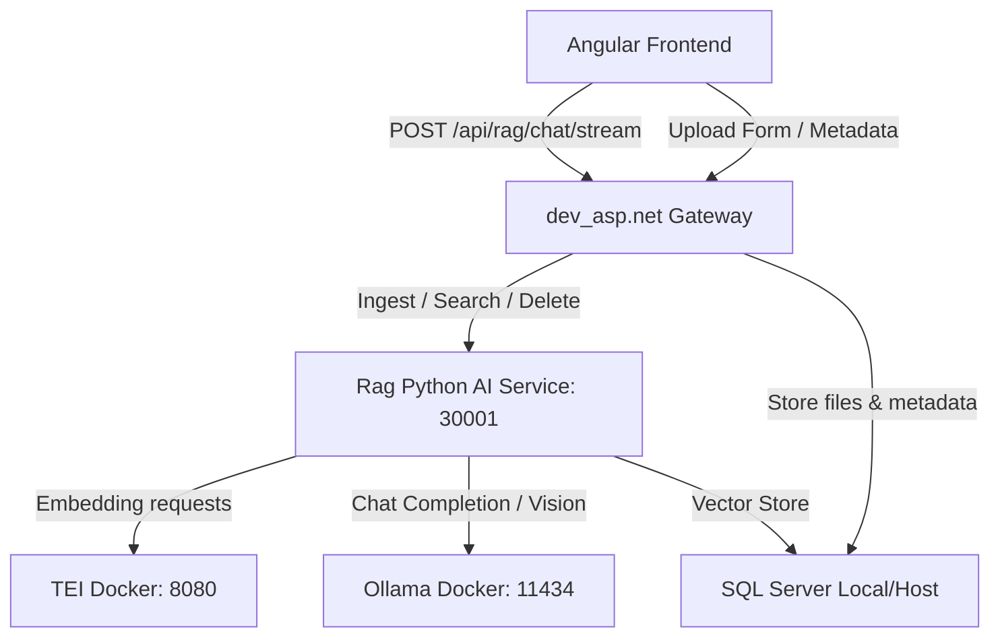

# Hướng dẫn Bàn giao & Triển khai Hệ thống RAG AI Service

Tài liệu này hướng dẫn chi tiết các bước thiết lập, cấu hình và chạy hệ thống dịch vụ RAG AI Service viết bằng Python FastAPI, kết nối với cổng Gateway của dự án ASP.NET Core và giao diện Angular.

---

## 1. Cấu Trúc Dự Án (Worktree)

```text
Rag/
├── app/                                 # Mã nguồn Python FastAPI (DDD Architecture)
│   ├── ai/                              # Agent, Guardrails, RAG Pipeline, Vision
│   ├── core/                            # Config, Database, Logging, Security, Middleware
│   ├── llmops/                          # Langfuse, LangSmith telemetry
│   ├── modules/                         # Chat, Document, Health modules
│   ├── routers/                         # FastAPI Routes & Dependencies
│   ├── shared/                          # Enums, Utils (Normalizer, Classifier, ...)
│   ├── config.py
│   ├── dependencies.py
│   ├── lifespan.py
│   └── main.py
│
├── configs/                             # File cấu hình & Quản lý thư viện phụ thuộc
│   ├── pyproject.toml                   # Cấu hình project, metadata & build tools
│   ├── requirements.txt                 # Danh sách thư viện Python dependencies
│   └── .env.example                     # Mẫu biến môi trường
│
├── infra/                               # Hạ tầng Docker & Kubernetes
│   ├── docker/
│   │   ├── docker-compose.yml           # Chạy Ollama (GPU/CPU) + TEI Embedding
│   │   └── Dockerfile                   # Dockerfile build Python RAG (khi cần đóng gói)
│   └── k8s/
│       └── rag-python.yaml              # Kubernetes manifest cho RAG Service
│
├── scripts/                             # Scripts tiện ích & Triển khai
│   ├── deploy_python.ps1                # Script tự động hóa deploy nếu cần
│   └── .env.ps1                         # Environment script
│
├── database/                            # Dữ liệu & Script Cơ sở dữ liệu SQL Server
│   ├── setup.sql                        # Script khởi tạo bảng & cấu hình vector
│   └── Db.bak                           # Bản sao lưu database mẫu
│
├── tests/                               # Bộ kiểm thử & Script xác minh
│   └── test_verify.py                   # Script kiểm tra 6 tiêu chuẩn kiến trúc
│
├── docs/                                # Tài liệu kỹ thuật & Hướng dẫn
│   ├── deployment_guide.md              # Hướng dẫn bàn giao & triển khai hệ thống
│   └── architecture/                    # Tài liệu kiến trúc chuyên sâu
│       ├── AI_AGENT_ARCHITECTURE.md
│       └── SYSTEM_ARCHITECTURE_GUIDE.md
│
└── .env                                 # File môi trường local (chạy trực tiếp trên máy)
```

---

## 2. Thành phần Kiến trúc Hệ thống



---

## 3. Khởi Chạy Hạ Tầng (Ollama + TEI Embedding qua Docker)

Hạ tầng AI nền tảng gồm **Ollama** (chạy mô hình LLM + Vision) và **TEI** (chạy mô hình Embedding `BAAI/bge-m3`) được khởi chạy nhanh chóng qua Docker Compose:

```bash
cd infra/docker
docker-compose up -d
```

- **Ollama**: Lắng nghe tại `http://localhost:11434`
  - Tải model LLM / Vision (ví dụ `qwen2.5vl:7b`):
    ```bash
    docker exec -it ollama ollama pull qwen2.5vl:7b
    ```
- **TEI (Text Embeddings Inference)**: Lắng nghe tại `http://localhost:8080` (sẵn sàng sinh vector 1024 chiều).

---

## 4. Thiết lập Cơ sở Dữ liệu SQL Server

1. **Khởi tạo bảng Vector phía Python AI**:
   Chạy script [setup.sql](file:///f:/BKU/Nam%203/Intern/Intern/Rag/database/setup.sql) trong thư mục `database/` trên SQL Server.
2. **Khởi tạo bảng Quản lý tài liệu phía Gateway ASP.NET**:
   Chạy file script SQL `migrations_rag.sql` trên cơ sở dữ liệu chính của Gateway (`RagDocuments`, `RagDocumentRoles`).

---

## 5. Khởi Chạy Dịch Vụ RAG Python Trực Tiếp Trên Máy Local

Tương tự cách chạy của dự án **Local AI Agent**, dịch vụ Python chạy trực tiếp trên máy host để tối ưu hiệu năng phát triển và debug:

### Yêu cầu hệ thống:
1. Python 3.11 hoặc cao hơn.
2. Tesseract OCR (đã cài đặt gói ngôn ngữ tiếng Việt `vie`).
3. SQL Server ODBC Drivers (Driver 17 hoặc 18).

### Các bước khởi chạy:
1. Mở terminal tại thư mục gốc [Rag](file:///f:/BKU/Nam%203/Intern/Intern/Rag):
   ```bash
   cd "f:\BKU\Nam 3\Intern\Intern\Rag"
   ```
2. Khởi tạo và kích hoạt môi trường ảo (Virtual Environment):
   ```powershell
   python -m venv venv
   .\venv\Scripts\activate   # Trên Windows
   ```
3. Cài đặt các thư viện phụ thuộc:
   ```bash
   pip install -r configs/requirements.txt
   ```
4. Cấu hình file `.env` tại thư mục gốc (tham khảo mẫu tại `configs/.env.example`):
   ```env
   UPRAG_LMSTUDIOENDPOINT=http://localhost:11434/v1
   UPRAG_MODELID=qwen2.5vl:7b
   UPRAG_APIKEY=ollama
   TEI_URL=http://localhost:8080
   SQLSERVER_CONNECTIONSTRING=Driver={ODBC Driver 18 for SQL Server};Server=localhost;Database=RagVectorDb;User Id=sa;Password=REPLACE_SA_PASSWORD;TrustServerCertificate=True;
   ```
5. Khởi chạy dịch vụ FastAPI:
   ```bash
   uvicorn app.main:app --host 0.0.0.0 --port 30001 --reload
   ```

---

## 6. Kiểm Thử & Xác Minh

Chạy bộ kiểm tra kiến trúc tự động:
```bash
python tests/test_verify.py
```

Truy cập Swagger UI kiểm tra API:
- [http://localhost:30001/docs](http://localhost:30001/docs)
- Các router chính:
  - `GET /health` & `GET /api/v1/health`: Kiểm tra trạng thái máy chủ.
  - `POST /db/upload` & `POST /api/v1/document/upload`: Xử lý nạp tài liệu.
  - `POST /v1/chat/stream` & `POST /api/v1/chat/stream`: RAG Chat SSE.
  - `DELETE /db/documents/{backend_id}`: Xóa tài liệu và vector.
